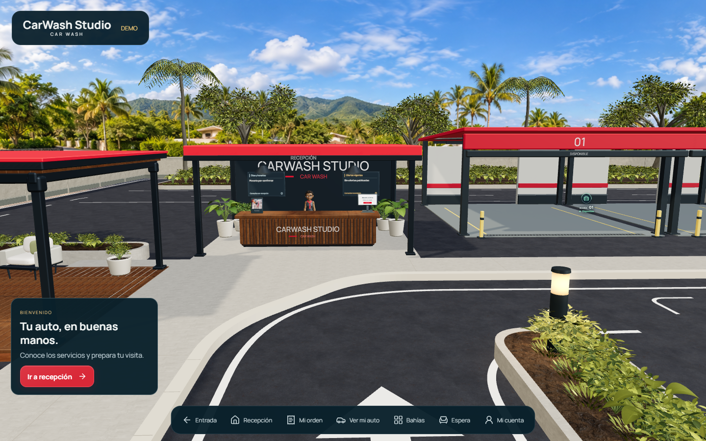
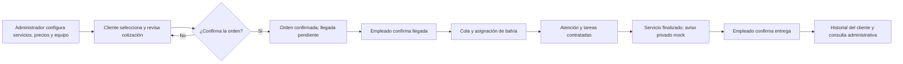
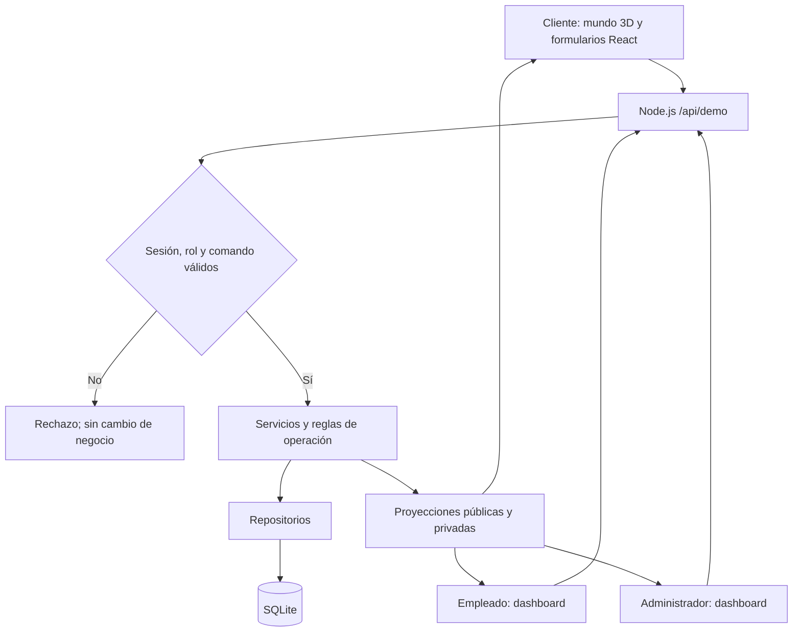

<div align="center">

# CarWash Studio

### Tu car wash, convertido en una experiencia web que se puede recorrer.

Explora los servicios, prepara una orden y sigue su atención desde un entorno 3D conectado con el equipo del negocio.

**Spatial Web App · React + Three.js · Node.js + SQLite · MVP local v0.1.0**

[Ver caso de estudio](https://estjuanpablotorres.wixsite.com/tech-portfolio-hub/portfolio-collections/my-portfolio/carwash-studio-spatial-web-app) · [Recorrido completo en 19 pasos](docs/evidence/release-v0.1.0/journey/README.md) · [Versión inicial](https://github.com/JuanPabloTorres/3D-Cars-Wash/tree/v0.1.0)

</div>



> **Estado del proyecto:** MVP funcional local con cuentas, roles, catálogo configurable y persistencia SQLite. El portafolio contiene capturas de la aplicación ejecutada; no es una demo pública del backend. Pagos, mensajes externos y agente IA siguen pendientes.

## La idea

Una web de servicios suele separar la presentación del negocio de lo que ocurre después de solicitar atención. CarWash Studio explora una alternativa: convertir las áreas del establecimiento en puntos de entrada al recorrido del cliente.

La **recepción** permite conocer y seleccionar servicios; el **área de espera** muestra el turno; las **bahías** representan el progreso; y **Mi cuenta** conserva el acceso y el historial. El usuario navega por destinos y controles web, sin aprender a manejar un personaje.

El personal trabaja en dashboards convencionales. El entorno espacial y esos paneles comparten el mismo backend y las mismas reglas.

**El objetivo es hacer el servicio más comprensible y reconocible para el cliente.** La mejora de conversión, satisfacción o productividad es una hipótesis que deberá medirse en pilotos; no un resultado comercial demostrado.

## Un producto, tres perspectivas

| Cliente | Empleado | Administrador |
| --- | --- | --- |
| Registro, login y cuenta privada | Acceso al panel de atención | Acceso al panel de gestión |
| Catálogo por tipo de vehículo | Confirmación de llegada | Creación y desactivación de usuarios del equipo |
| Selección, cotización y orden | Cola, asignación de bahía y tareas | Servicios, precios y tiempos por categoría |
| Espera y seguimiento del servicio | Finalización y confirmación de entrega | Ofertas y contenido del local |
| Aviso interno e historial | Acciones limitadas por su rol | Consulta de órdenes, clientes y operación |

### Del catálogo a la entrega



**Regla central:** una animación no autoriza una transacción. Confirmar una orden, registrar llegada, finalizar atención, entregar y pagar son hechos distintos. El pago permanece pendiente en este MVP.

## El recorrido, en imágenes

Las siguientes son capturas reales con datos de demostración. El [recorrido completo](docs/evidence/release-v0.1.0/journey/README.md) conecta la configuración del administrador con una misma orden del cliente y su atención por el empleado.

| Seleccionar y cotizar | Esperar y consultar |
| --- | --- |
|  |  |

| Gestionar el equipo | Completar la atención |
| --- | --- |
|  |  |

**También documentado:** login, registro, tarifas y minutos para cuatro categorías, publicación de ofertas, confirmación de orden, asignación, aviso privado, reingreso e historial. La galería del portafolio reúne **26 capturas: 7 vistas generales y 19 pasos del recorrido**.

## Tecnología y decisiones de ingeniería

| Capa | Tecnología | Función en el producto |
| --- | --- | --- |
| Interfaz | React 19, TypeScript, CSS, Lucide | Formularios, navegación, paneles y controles accesibles |
| Experiencia espacial | Three.js, React Three Fiber, Drei | Escena 3D, cámaras y elementos interactivos anclados al entorno |
| Estado del cliente | Zustand | Borrador, sesión y proyecciones recibidas del servidor |
| Backend | Node.js 22.19, HTTP nativo | API, comandos, sesiones y servicio de archivos compilados |
| Persistencia | SQLite mediante `node:sqlite` | Usuarios, configuración y checkpoint de la operación |
| Autenticación | JWT con `jose`, cookies HttpOnly, scrypt | Identidad, validación de sesión y contraseñas; permisos comprobados en servidor |
| Actualización | Server-Sent Events y consultas de recuperación | Sincronización de estado público y datos privados |
| Recursos visuales | Blender, glTF/GLB, texturas PBR | Preparación de recursos, materiales y componentes reutilizables |
| Calidad | Vitest, Playwright, TypeScript | Contratos, integración, flujos de navegador y compilación |
| Empaquetado | Vite, Dockerfile, Compose | Builds web/servidor y definición del contenedor local; ejecución Docker pendiente |

### Cómo está conectado



- **Servicios y repositorios:** autenticación, catálogo y persistencia tienen responsabilidades separadas. `SqliteRepository` concentra la base común; los repositorios concretos conservan sus contratos.
- **Composición e inyección:** `createLocalServices` comparte una conexión SQLite e inyecta repositorios en los servicios. No hay un contenedor DI adicional.
- **Dominio operativo:** `DemoOperationSource` mantiene cola, tareas, ocupación, traslados y entrega. El renderer observa ese estado.
- **Identidad y privacidad:** JWT en cookie HttpOnly; el rol y la revocación se comprueban contra los datos persistidos. Las órdenes privadas no forman parte del estado público del mapa.
- **Persistencia honesta:** usuarios en tabla; catálogo y checkpoint operativo como documentos JSON dentro de SQLite. No se presenta como un esquema analítico de órdenes normalizadas.
- **Reutilización visual:** prefabs de macetas, materiales, señalización y capas evitan crear una implementación distinta por ubicación.

Los vehículos de la capa operativa se representan mediante **medallones e indicadores de estado**, según el diseño actual; no mediante automóviles 3D animados.

### Mapa del código

| Ubicación | Responsabilidad |
| --- | --- |
| [src/world](src/world) | Escena, capas, cámaras y prefabs |
| [src/ui](src/ui) y [src/reception](src/reception) | Interfaz del cliente, cuenta y contratación |
| [src/app/commerceStore.ts](src/app/commerceStore.ts) | Estado comercial del cliente y comunicación con la API |
| [src/domain](src/domain) | Contratos, precios, estados y operación |
| [server/demoApi.ts](server/demoApi.ts) | Frontera HTTP, permisos y comandos |
| [server/services.ts](server/services.ts) | Servicios y composición de dependencias |
| [server/persistence.ts](server/persistence.ts) | SQLite, repositorios y checkpoints |
| [server/users.ts](server/users.ts) y [server/sessionTokens.ts](server/sessionTokens.ts) | Usuarios, contraseñas y JWT |
| [server/start.ts](server/start.ts) | Servidor Node independiente |
| [tests](tests) | Pruebas unitarias, integración y navegador |

## A quién puede aportar valor

La primera hipótesis comercial es un **piloto personalizado para un car wash o centro de detailing con local físico**, catálogo diferenciable y disposición para mantener actualizados sus estados de atención.

También puede interesar a agencias que construyen experiencias digitales para negocios automotrices. Su adaptación a concesionarios u otros servicios es una posibilidad de evolución, no una capacidad entregada de forma genérica.

La propuesta inicial es **implementación por negocio + mantenimiento**, antes de plantear un SaaS de múltiples empresas. El proyecto actual no implementa aislamiento multiempresa ni gestión multisucursal.

[Consultar segmentos, oferta piloto y plan de comercialización](docs/COMMERCIALIZATION.md)

## Ejecutar el MVP local

**Requisito:** Node.js 22.19, versión fijada también en el Dockerfile, con `node:sqlite`. En Node 22 puede aparecer su advertencia experimental.

```bash
npm ci
npm run build
npm run build:server
npm start
```

| Acceso | URL local |
| --- | --- |
| Experiencia del cliente | http://127.0.0.1:4173/ |
| Login / registro del cliente | http://127.0.0.1:4173/login |
| Administración | http://127.0.0.1:4173/admin |
| Empleados | http://127.0.0.1:4173/employee |
| Salud del servidor | http://127.0.0.1:4173/healthz |

Para desarrollo: `npm run dev`. Para preview de Vite: `npm run build` y `npm run preview`. Usar una alternativa a la vez; no iniciar dos procesos operativos sobre la misma base SQLite.

**Primer administrador:** abrir `/admin` y completar la creación de cuenta con la clave local de instalación generada en `server/.local-admin-token`. Después se accede con usuario y contraseña y se crean los empleados desde el panel. La clave, las contraseñas y la base no se comparten ni se suben a Git.

La base predeterminada es `server/data/carwash.sqlite`; `CARWASH_DB_PATH` permite elegir otra ruta. La clave JWT persistente se guarda junto a la base. Reiniciar el servidor conserva los datos guardados; el tiempo apagado no finaliza servicios.

Consultar [instalación, roles, sesiones y respaldo](docs/LOCAL_STAFF_SQLITE.md) para los detalles. El backend acepta el entorno local: copiar `dist/` a un hosting estático no activa login, órdenes ni administración.

## Verificación

**Evidencia de la versión inicial, 24 de octubre de 2026:** 90 pruebas unitarias/integración, cuatro recorridos de navegador y compilaciones web/servidor. El recorrido administrativo–cliente–empleado se volvió a ejecutar para la galería: **PASS, 2.2 minutos**, con base temporal y cuentas sintéticas.

```bash
npm test
npm run build
npm run build:server
npx playwright test --config playwright.staff.config.ts
```

La suite staff usa el puerto 4175 y SQLite temporal. Comprueba registro/login/logout, permisos negativos, tarifas por categoría, ofertas, atención, entrega, revocación y persistencia tras reinicio. Las pruebas históricas con comandos antiguos no deben confundirse con esta suite vigente.

- [Informe de validación y fallos conservados](docs/MVP_VALIDATION.md)
- [Notas de v0.1.0](docs/RELEASE_v0.1.0.md)
- [Secuencia reproducible de capturas](docs/evidence/release-v0.1.0/journey/README.md)

Estos resultados documentan ejecuciones concretas; no sustituyen pruebas de carga, revisión de seguridad de producción o validación en dispositivos físicos.

## Qué está listo y qué sigue

| Disponible en el MVP local | Pendiente para una oferta de producción |
| --- | --- |
| Cuentas, roles y JWT | Despliegue público, HTTPS y revisión de cookies/orígenes |
| SQLite y recuperación tras reinicio | Operación de backups, restauración y monitoreo en el destino final |
| Catálogo, precios y tiempos configurables | Integración de pagos y conciliación |
| Atención y entrega por personal | Mensajería externa con proveedor real |
| Aviso privado en la aplicación | Ana como agente IA; hoy su atención es guiada |
| Capturas y flujos E2E | Rendimiento/accesibilidad en dispositivos reales y pruebas con clientes |
| Dockerfile y Compose | Construcción y ejecución del contenedor verificadas |

La apariencia continúa siendo iterable. No se promete equivalencia exacta con las imágenes conceptuales, rendimiento universal ni un incremento de ventas medido.

## Recursos y créditos

Los recursos de terceros conservan sus atribuciones en [ASSET_LICENSES.txt](public/ASSET_LICENSES.txt). El [inventario](docs/ASSET_INVENTORY.md) describe la procedencia de los activos. Revisar el inventario aplicable y las condiciones de cada recurso al preparar una distribución comercial.

---

**Un establecimiento como interfaz. Una operación compartida detrás.**

[Explorar el caso de estudio en JP Tech Studio](https://estjuanpablotorres.wixsite.com/tech-portfolio-hub/portfolio-collections/my-portfolio/carwash-studio-spatial-web-app) · [Ver el código de v0.1.0](https://github.com/JuanPabloTorres/3D-Cars-Wash/tree/v0.1.0)
