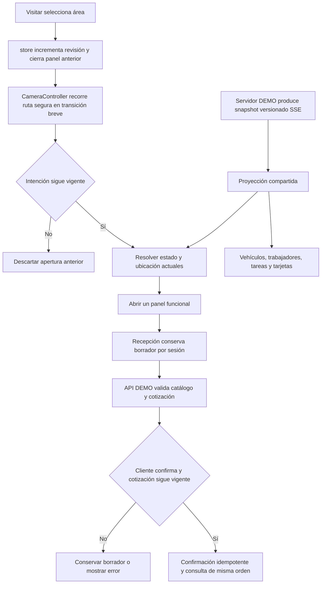

# Febles — experiencia comercial por áreas

Reporte histórico de la navegación comercial. La revisión visual y los recursos vigentes están en [VISUAL_REVISION.md](VISUAL_REVISION.md); sus cuatro vehículos y nuevas ilustraciones sustituyen las limitaciones de recursos descritas aquí.

Fecha: 23-10-2026. Baseline Git: `6849da9c82b138b548428b179a28a990c6b9db93`. El árbol contiene las eliminaciones intencionales de la aplicación anterior y la nueva implementación sin commit; no se recuperó código eliminado.

## Alcance y resultado

Se conserva el mundo R3F/Drei. Se reemplaza la navegación de videojuego por vistas funcionales dentro del mismo Canvas. Las once imágenes conceptuales del ZIP se revisaron como dirección visual, sin usarlas como fondos ni presentarlas como evidencia. Las capturas de implementación están en `evidence/commercial-polish/`.

| Componente reutilizado | Responsabilidad y fuente | Cambio | Comprobación |
|---|---|---|---|
| store / CameraController / WaypointPathPlanner | Selección y ruta segura | Revisión de intención, transición 0.55–1.15 s, apertura automática; movimiento reducido 0.08 s | Cambio rápido y última selección; imágenes reales |
| WorldHUD | Accesos y contexto | Visitar con 4 destinos; ayuda secundaria; controles de prueba apartados | Menú y acciones de cada zona en escritorio/móvil |
| ReceptionDialogue / catálogo | Atención con Ana y 3 IDs existentes | Borrador compartido, miniaturas, registro de 4 tipos, revisión y confirmación | Volver, validación, totales, error/red y expiración |
| OrderStatusCard | Consulta de orden | Consume la misma respuesta del proveedor; compacto/detallado y cancelación | Refresh, cancelación aceptada/rechazada y aislamiento |
| DemoOperationSource / OperationProjection | Operación ilustrativa, revisiones y tareas | Fuente en servidor, snapshots SSE; asignación explícita de trabajador y servicios seleccionados | Dos contextos, reconexión, eventos obsoletos y pausas |
| VehiclePrefab / VehicleAppearance | GLB, materiales y trayectoria | Conserva 4 ruedas profesionales, pivotes centrados, giro por distancia/radio y dirección | Unitarias a 30/120 FPS y medida de movimiento real |
| StaffPrefab / rig profesional | Saludo y clips | Saludo antes de conversación, sin repetición continua; 3 clips de trabajo específicos nuevos | GLB validado y capturas por actividad |
| WeatherEnvironmentController / EnvironmentBoundary | Ambiente y clima | Sky de Three r186, radiancia atmosférica calibrada antes de ACES; misma familia vegetal y LOD | Comparación de capturas, sin aumentar exposición global |
| WorldPanel | Formularios y datos estables | Un panel principal, foco/Escape, sheet móvil, visualViewport y scroll | Móvil táctil, foco y controles de 44 px |

La selección de áreas no tiene comandos de negocio. Cada destino aporta datos o acciones: recepción prepara; orden consulta/solicita cancelación; vehículo resuelve observación o explica falta de ubicación; local muestra tareas/disponibilidad, cola o espera relacionada con la orden. La entrega no es un tab que complete servicios.

## Flujo y contratos

Pseudocódigo: seleccionar área incrementa revisión; resolver camino seguro; cerrar panel anterior; interpolar cámara durante una duración limitada; antes de terminar resolver de nuevo la asignación del vehículo; si la revisión sigue vigente abrir información actual. La última selección cancela las anteriores. El borrador no pertenece al componente de diálogo.

Cotizar envía IDs y datos mínimos al proveedor, que calcula centavos y vencimiento. Confirmar usa la ID de la cotización como clave idempotente; navegar o cerrar no cancela. Solicitar cancelación requiere confirmación explícita y respuesta del proveedor. El pago permanece pendiente. El inicio de atención solo se ejercita con un comando explícito de herramientas DEMO.

El transporte usa snapshots completos, streamId y revisión; descarta eventos viejos del mismo flujo y vuelve a sincronizar al reconectar. Las tarjetas de otros vehículos no contienen costos, contacto ni orden. La posición representada es ilustrativa, no tracking físico.

## API local y frontera de producción

`server/demoApi.ts` se integra con Vite dev/preview, sin dependencias nuevas de servidor. `/api/demo/session`, `quote`, `confirm`, `cancel`, `operation` (SSE), `tools` (sandbox). Cookies HttpOnly/SameSite Strict, nonce de sesión y comprobación de origen para mutaciones; catálogo y totales del servidor, límites de cuerpo y separación de órdenes por sesión.

Las herramientas cambian únicamente registros sintéticos. `?tools=demo` es una entrada de pruebas, NO una autorización administrativa real. Falta conectar un backend comercial y roles de producción. Datos en memoria: se pierden al reiniciar el proceso; la aplicación informa reinicio de sesión. No hay pagos, emails ni verificación de llegada física.

## Validación ejecutada

- `npm test`: 34 pruebas unitarias aprobadas.
- `npm run build`: aprobado. Advertencia de bundle grande conservada, ~1.47 MB / 424 KB gzip.
- `npm run test:e2e`: 12/12 aprobadas en Edge, 2.8 minutos (campaña final después de agrupar carrocería). Incluye móvil 390×844, cambios rápidos, servicios/registro/revisión, total correcto, confirmación/doble clic, recuperación, cancelación aceptada y rechazada, fallo de proveedor, cotización vencida, sesión ajena/CSRF, dos contextos/reconexión, ruedas, GLB fallido y seis ambientes.
- Navegación a recepción: 979 ms observados en la campaña, sin pulsar E. No es SLA.
- Cambio de tarea del servidor a segundo contexto: 973 ms observados en localhost. Es una prueba del sandbox, no del administrador de producción ni de una red remota.
- Ruedas: cuatro conjuntos; radio observado ~0.446 m; desplazamiento y rotación relacionados, detención al pausar. `final/wheel-motion.json`.
- Validación GLB: ver `asset-validation.json`. No sustituye evaluación artística.

Las nueve pruebas antiguas y sus capturas siguen como historial del recorrido de caminata anterior. No se cuentan como ejecución actual. La prueba de expiración de UI usa una respuesta vencida controlada; la política del reloj del proveedor tiene prueba unitaria independiente. El fallo GLB genera un error esperado, separado de la consola de los flujos normales.

## Incidentes preservados

1. Captura baseline intentó una etiqueta de destino antigua incorrecta. Se conservaron entrada/recepción y las capturas previas de bahía; no se presenta aquella captura interrumpida como una auditoría completa actual.
2. Primer test de pausa entre contextos ejecutó el servidor previo al nuevo contrato de pausa. Reiniciar el servidor actualizado resolvió esa divergencia de entorno.
3. El formulario móvil ampliaba el panel con `:has(input:focus)`; al desenfocar movía el botón antes del click. Se retiró ese cambio de geometría y se usa visualViewport/scroll. Caso móvil pasó después.
4. Offline no terminaba automáticamente un SSE ya abierto. Se corrigió en DemoOperationTransport: cerrar al evento offline, conservar snapshot y abrir una conexión al evento online. Prueba de reconexión pasó.
5. La miniatura de interior quedó vacía en tres capturas: BodyUnderside es una malla padre de las piezas interiores. Se reemplazó completamente la selección por visibilidad heredada por capas de cámara independientes. Se revisaron exterior, asientos y focos reales del GLB; no hay fallback de imagen vacía. Capturas de asset son vistas ilustrativas, distintas de la evidencia del mundo completo.
6. Readiness se publicaba al resolver assets antes de pintar el mundo, produciendo una captura inicial solo de cielo. Ahora espera dos frames del renderer y un frame de presentación; entrada real revisada después.

Fallas E2E y trazas históricas: `evidence/commercial-polish/failures/attempt-1` y `attempt-2`. No se borraron para presentar un resultado perfecto.

## Límites y gate

- Aprobación artística pendiente. Vegetación lejana y materiales todavía necesitan revisión contra los conceptos; no se afirma equivalencia cinematográfica.
- Solo hay un modelo de carro apto. Pickup, truck y SUV son categorías distintas de registro, pero faltan sus GLB y validación dimensional. Se informa su falta; no se reutiliza el deportivo como sustituto.
- Ruedas funcionales corresponden al carro disponible; no se han verificado en tres modelos inexistentes. Puertas no se fuerzan ni se deforman para simular acceso.
- Hay posiciones/clips distintos para tareas y agua limitada solo durante exterior activo; faltan herramientas profesionales portátiles de aspirado, focos y lavado para completar la representación operativa.
- No hay backend comercial real, autenticación de producción, pagos o almacenamiento duradero. Reasignación administrativa real y su prueba end-to-end están pendientes de ese contrato.
- La prueba usa Edge de escritorio y móvil emulado con el GPU del PC; no Safari ni teléfono físico. No se certifica teclado virtual de un teléfono real.
- Las órdenes DEMO son locales a la sesión; no representan la orden real de un usuario ni sus posiciones físicas. Tiempos de una orden sin planificación autorizada se muestran como no disponibles.

No se expandió la arquitectura a otro motor ni se compraron recursos. La decisión del usuario sobre aceptación artística sigue siendo el gate para ampliar el mundo.

## Rendimiento y recursos

Las mediciones son ventanas cortas en Edge, Intel UHD/ANGLE D3D11; no son un benchmark de teléfono.

| Escenario | FPS medios | P95 | Draw calls | Triángulos | Texturas | Carga observada |
|---|---:|---:|---:|---:|---:|---:|
| quiet | 38.9 | 36.6 ms | 853 | 2,051,278 | 102 | 3.06 s |
| busy | 28.7 | 45.1 ms | 1260 | 3,121,960 | 171 | 3.15 s |

Antes de reagrupar la carrocería se observaron 1521 draw calls y 23.6 FPS en busy; después, 1260 llamadas y 28.7 FPS. Se conservaron cuatro ruedas, se repitió la prueba de desplazamiento y se revisaron capturas posteriores. Ventanas variables; no se afirma que todo el mundo mantenga una tasa fija. La prueba móvil de galería mezcla varias vistas/pausa y no se compara como benchmark sostenido. Memoria GPU no disponible.

La auditoría npm de esta ejecución devolvió HTTP 400 del endpoint de seguridad remoto retirado. Resultado NO CONFIRMADO, conservado en commercial-dependency-audit.json; no se reporta un PASS de auditoría.

Capturas y videos reales: desktop-experience.webm y mobile-experience.webm en evidence/commercial-polish/final. Los renders aislados de miniaturas se identifican como vistas de asset y no se usan para probar la aplicación completa.

## Comparación con los conceptos del ZIP

| Referencia conceptual | Resultado observado | Diferencia/péndiente |
|---|---|---|
| 01 Llegada | Entrada real, marca, cielo, recepción visible, Visitar y CTA útil | Señalización/arquitectura más sencillas; vegetación no alcanza la densidad del render |
| 02 Recepción | Ana real conservada; saludo primero, tres intenciones y apertura automática | Se conserva el personaje del proyecto, no el personaje alternativo del concepto |
| 03 Servicios | Tres tarjetas visuales, selección persistente y resumen | Miniaturas del GLB real, no fotografías de un servicio profesional |
| 04 Registro | Cuatro categorías distintas, color y contacto opcional DEMO validado | No se inventa catálogo de marcas/modelos; tres recursos 3D específicos pendientes |
| 05 Cotización | Tres servicios totalizan $66.90; vigencia y validación del proveedor, editar/guardar/confirmar | No hay tarifas ni impuestos comerciales verificados |
| 06 Orden | La confirmación crea una orden consultable; pago/llegada separados y cancelación condicionada | Sin backend real ni persistencia duradera |
| 07 Vehículo | Cámara segura, auto visible, tarjeta compacta y ampliación | Modelo conceptual disponible, sin SUV equivalente; ubicación ilustrativa |
| 08 Cola | Posiciones y conteo provistos por la operación; consulta de bahías | No se representa una cola vacía como fallo; entorno aún más sencillo que el concepto |
| 09 Lounge | Vista de espera sin el letrero que obstruía; consulta de orden y otras zonas | Mobiliario/densidad ambiental inferiores a la imagen; no se añade decoración sin función |
| 10a/10b Móvil | Mismo menú de cuatro accesos; rostro y auto visibles sobre sheet compacto/expandible | Teclado físico/virtual de un teléfono real y Safari pendientes |

## Límite del observador

Visual Agent Live se intentó iniciar con el CODEX_THREAD_ID real y reutilizar su vista. Su lanzador no encontró una consulta observada y el helper final rechazó la atribución con «No hay una consulta identificada». No se fabricó una sesión ni un resultado del observador. El informe estructurado quedó conservado en `commercial-completion-report.json`, junto con la evidencia independiente de Playwright.
