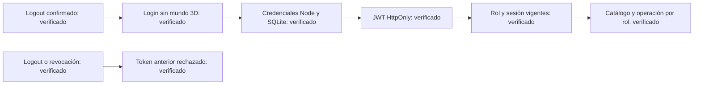
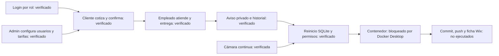

# MVP local: auditoría del 24 de octubre de 2026

## Alcance

Aplicación de demostración local con experiencia espacial para clientes y dashboards separados para empleados y administradores. No es un servicio público de producción. Los pagos permanecen pendientes; el aviso de recogida es privado dentro de la aplicación (`in-app-mock`). SMS, correo transaccional y agente IA no están conectados.

## Cambios de esta iteración

- Cámara continua, interrumpible desde la posición renderizada, recorrido redondeado de acceso al lounge y respeto de movimiento reducido.
- Cuentas de cliente sobre el mismo dueño de la sesión comercial. Registro fuerza rol cliente; la interfaz nunca concede roles. Logout, expiración y revocación conservan el dueño de la orden sin dejar la cookie autorizada.
- Migración SQLite 2 incorpora clientes sin cambiar IDs ni hashes anteriores. Servicios y repositorios conservan los límites de autenticación, catálogo y operación; inyección en `createLocalServices`.
- Precio y minutos estimados por servicio y categoría (Carro, Pickup, Truck, SUV). Las cotizaciones congelan ambos valores. Un tiempo estimado no completa tareas automáticamente.
- Servidor Node independiente con assets compilados, `/healthz`, comprobación local de Host, CSRF por origen y nonce, cookies HttpOnly y permisos por rol.
- Dockerfile sin usuario root y Compose con puerto publicado únicamente en 127.0.0.1 y volumen SQLite persistente. Docker aún NO ejecutado satisfactoriamente.

## Evidencia ejecutada

| Comprobación | Resultado |
| --- | --- |
| `npm test` | 86 pruebas, 19 archivos, PASS |
| `npm run build` | TypeScript y frontend PASS |
| `npm run build:server` | Servidor empaquetado PASS |
| `node scripts/test-standalone.mjs` | HTTP real: assets, salud, Host, CSRF, cookies y aislamiento de roles PASS |
| Playwright staff: administrador → catálogo/oferta/empleado → registro cliente → orden → llegada/servicio → reinicio SQLite → aviso → entrega → relogin | PASS en ejecución final: 2 pruebas de navegador en 2.1 min incluyendo navegación |
| Playwright navegación escritorio/móvil, interrupción, sin desvanecimiento y movimiento reducido | PASS |
| `npm audit --omit=dev --json` | 0 vulnerabilidades reportadas; no equivale a auditoría exhaustiva de seguridad |
| Login navegador de `cliente.mvp`, `empleado.mvp`, `admin.mvp` en 4173 | PASS para los tres roles; dashboards sin canvas |
| `docker compose config --quiet` | PASS de configuración; no prueba construcción ni ejecución del contenedor |
| `git diff --check` con `cr-at-eol` para archivos Windows | PASS |

Capturas reales: `docs/evidence/sqlite-integration/`. El resultado visual aún no equivale a una aprobación artística del usuario.

## Intentos conservados

- La primera captura del lounge se tomó antes de que React cambiara la vista. Se corrigió el arnés para esperar `view=waiting` además de `transition=false`; la nueva captura muestra el lounge.
- El primer smoke test usó `fetch` para falsificar Host y obtuvo 200: ese cliente controla el encabezado. Se sustituyó por HTTP nativo, que envía el Host solicitado; el servidor respondió 403. No se relajó el control del producto.
- Docker Desktop 4.91.0 se cierra al iniciar porque `sailor-ingest.sock` no puede abrirse/renombrarse. No hay `dockerd` alternativo instalado en WSL. Dos intentos de retirar el socket temporal fueron rechazados por la revisión automática. No se ejecutó esa eliminación.

## Seguimiento: logout, JWT y auditoría de cuentas

Petición del usuario: cerrar sesión debe abrir login; probar registro, administración autenticada, empleados, estados, servicios, precios y ofertas. Durante el trabajo pidió JWT y backend Node.js.

**Causa reproducida:** `AccountModal` invalidaba la sesión pero sólo cerraba el modal; `/login` tampoco tenía una ruta propia. Playwright esperaba `/login` y recibió `/?layer=reception` durante 20 segundos. Se conserva aquí el resultado previo a la reparación; no era un problema de contraseña ni de SQLite.

**Cambio:** `/login` reutiliza el formulario de cuenta y abre `/world3d` tras autenticación. Logout sólo navega después de la confirmación del servidor. Los errores permiten reintentar; el registro móvil permite desplazarse a todos sus enlaces. Administración y empleados conservan sus pantallas de acceso separadas.

**Autenticación:** el backend Node.js emite JWT HS256 con `jose` para los tres roles, en cookie HttpOnly/SameSite=Strict. Verifica algoritmo, tipo, firma, emisor, audiencia, vencimiento, antigüedad e identidad de sesión. SQLite mantiene revocación y rol vigente; el JWT no contiene permisos, contraseñas, nombres ni órdenes. Una cookie con sólo el ID de una sesión autenticada no sustituye la firma. La clave separada persiste junto a SQLite, excluida de Git y Docker build. Las sesiones autenticadas anteriores requieren un nuevo login, conservando cuentas e historial.

| Comprobación de este seguimiento | Resultado ejecutado |
| --- | --- |
| `npm test` | 89 pruebas en 20 archivos, PASS |
| Build TypeScript/frontend y servidor Node con `jose` incluido | PASS |
| Playwright `playwright.staff.config.ts` | 4 pruebas, PASS en 2.6 min |
| Login/logout cliente, error de logout, contraseña incorrecta y recuperación de cuenta | PASS en navegador |
| Registro móvil, duplicado, contraseña corta y recuperación de conexión | PASS; repetido tras corregir scroll, 1 prueba PASS en 13.7 s |
| Admin login normal, creación de empleado/servicio, edición de 4 tarifas y tiempos | PASS; tarifas comprobadas desde catálogo del cliente |
| Creación, edición y retirada de ofertas; visualización pública en lounge | PASS |
| Empleado: llegada, asignación, finalización, entrega; aviso privado; recuperación de historial por login | PASS |
| Reinicio SQLite conservando usuarios, JWT activo, catálogo, ofertas y tarea en curso | PASS en base aislada |
| JWT inválido, sin firma, expirado, emisor/audiencia incorrectos, ID sin firma y replay tras logout | PASS; pruebas unitarias y HTTP real |
| Servidor Node compilado: rutas, salud, JWT, logout, CSRF, Host y permisos | PASS (`scripts/test-standalone.mjs`) |
| Activación 4173: login/logout navegador de cliente, empleado y administrador con JWT | PASS; 3 cuentas existentes preservadas |

Las pruebas de catálogo y operación usan SQLite temporal en 4175; no sustituyen los servicios ni precios del usuario. La suite histórica por defecto contiene accesos de administración retirados y mutaciones sobre 4173; en este seguimiento se ejecutó la suite vigente aislada, no esos flujos históricos.

Capturas: `customer-login-desktop.png`, `customer-registration-mobile.png` y `customer-published-offers.png` en `docs/evidence/sqlite-integration/`.

Activación JWT realizada tras respaldo SQLite consistente en `.cache/backups/pre-jwt-1792868893005.sqlite`. Servidor Node independiente ejecutando el nuevo bundle; la base previa contenía 3 cuentas y ninguna orden ni historial que perder. El observador Visual Agent Live no confirmó la apertura de su panel durante este seguimiento; las comprobaciones anteriores proceden de ejecución directa, no de ese observador.

## Bloqueo de entrega

**Blocker:** validar construcción, arranque y persistencia del contenedor requiere recuperar el motor Docker. No certificar el paquete Docker hasta ejecutarlo. La petición posterior autoriza publicar la versión inicial y su ficha de portafolio como MVP local, manteniendo explícita esta limitación de Docker.

Versión nativa activada en 4173 con `/healthz` verificado. Backup previo consistente: `.cache/backups/pre-mvp-1792867115240.sqlite`. Cuentas de prueba creadas y verificadas; contraseñas sólo en `.cache/mvp-test-accounts.json`. El servidor está ejecutando `dist-server/start.mjs`.

Destino Wix identificado: JP Tech Studio, colección My Portfolio (`b40c02a6-2405-4ce2-9bf6-2147b9fa29a9`). No existe todavía un proyecto Carwash en sus 14 proyectos. Sólo se realizaron lecturas; no se publicó contenido como terminado.

## Operación y rollback

1. `npm ci`, `npm run build`, `npm run build:server`, `npm start` para ejecución nativa local.
2. `docker compose up --build -d` cuando el motor funcione. El volumen `carwash-data` conserva DB y clave local de instalación. No usar `down -v` para actualizar.
3. La instalación nueva se inicializa desde `/admin` con la clave local; nunca incluir la clave en Git, capturas ni portfolio.
4. `node scripts/create-demo-accounts.mjs` crea las tres cuentas de prueba sin sobrescribir cuentas ajenas. Credenciales sólo en `.cache/mvp-test-accounts.json`, ignorado por Git y Docker.
5. Antes de migrar una DB existente, generar una copia SQLite consistente (`VACUUM INTO`/backup). Para rollback, detener el proceso, conservar la DB actual, restaurar esa copia junto con el código correspondiente y volver a probar login/órdenes. Nunca copiar sólo el archivo principal mientras WAL está activo.

## Flujo de aceptación observado

## Versión inicial v0.1.0 — ajustes del 24 de octubre

- El modal Mi cuenta oculta el terminal HTML de espera y los controles de operación; al cerrar se recuperan las acciones de la zona.
- Cámara inicial más cercana, giro por cuaterniones y un solo recorrido hacia el acceso del lounge. Abrir un diálogo no desplaza otra vez la cámara.
- Bienvenida con texto de 14 px y título de 21–22 px; navegación inferior adaptada hasta 900 px.
- Ejecutado: 89 pruebas en 20 archivos; build de frontend y servidor Node; cuatro recorridos Playwright con DB aislada (cliente, móvil, navegación y operación completa por roles). Tras el último ajuste de ruta y navegación se repite el recorrido afectado.
- Evidencia: `docs/evidence/release-v0.1.0/` y `docs/evidence/sqlite-integration/`. No se ejecuta el conjunto histórico que modifica el servidor del usuario; la validación de roles utiliza su propio servidor y base temporal.
- Alcance: MVP local. IA de Ana, pagos externos y mensajería externa pendientes. Docker preparado, ejecución no certificada. La aceptación artística corresponde al usuario.

Incidencia conservada: el primer reintento de navegación falló a 732 px porque la regla responsive heredaba translateX(-50%) de escritorio y dejaba Entrada fuera del viewport. Corregido con transform:none; se añadió una aserción de visibilidad de todos los destinos antes del clic. La evidencia del intento fallido permanece en .cache/staff-test-results hasta la siguiente ejecución.

Comprobación final: 90 pruebas pasan. El reintento de navegación tras corregir el breakpoint pasó (28.9 s). Se encontró además que redimensionar el lounge repetía el recorrido de entrada; ahora seleccionar o redimensionar la misma zona conserva la posición, con regresión unitaria específica.
