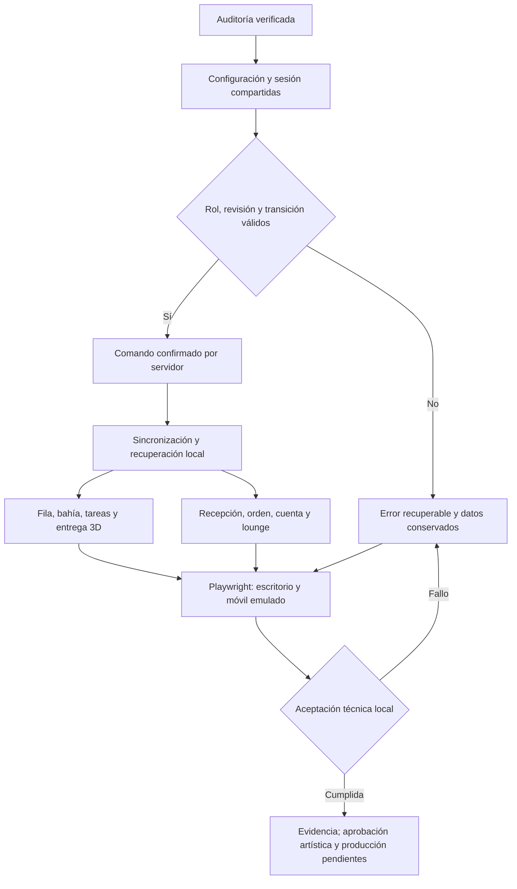

# Cierre integral — 23 de octubre de 2026

## Auditoría inicial observada

Repositorio: `C:\Projects\Repos\3D-Cars-Wash`. Se conserva el árbol de trabajo de la reconstrucción, incluidas las eliminaciones anteriores. No se restaura código descartado.

- Cliente ejecutado en Playwright: entrada y recepción funcionales, captura `evidence/sow-baseline-client.png`; consola sin errores de página.
- No existe una interfaz administrativa ni un proveedor de producción. `/api/demo/tools` es un fixture local, no administración autenticada.
- Cotización, confirmación idempotente, cookie privada y cancelación existen; las órdenes residen en memoria.
- El perfil muestra nombre y SUV fijos; cerrar sesión sólo cambia un anuncio. Debe corregirse en el propietario de sesión.
- Tarifas administradas sólo por JSON; contenidos y catálogo se importan desde constantes del cliente.
- Escenario inicial `mixed` contiene registros sintéticos sin orden comercial. Debe separarse del escenario operativo vacío.
- La imagen urbana se usa como fondo de cámara sin profundidad; debe ser un fondo físico lejano, separado del HDRI.
- Los accesos del mostrador tienen proxies HTML invisibles a coordenadas fijas. No prueban picking 3D y deben sustituirse por controles vinculados a los objetos.
- Fallo pendiente anterior: botón de reconexión desmontado por la recuperación periódica. Requiere comprobar su propietario y regresión.

## Contratos de esta iteración

Administración local protegida por clave local y cookie/nonce; nunca se presenta como identidad, pagos o permisos de producción. Los cambios de configuración y atención se validan en servidor con revisión y se reflejan en los consumidores actuales. No se inventan tarifas ni contacto oficial. La escena operativa inicia vacía; los fixtures quedan bajo `scenario` explícito. Las animaciones no completan el estado comercial.

## Plan y aceptación

1. Fuente compartida para configuración, sesión, contenido y atención.
2. Administración local: seis áreas, validación de conflictos, permisos y revisión.
3. Cuenta real de sesión DEMO y contacto confirmado por servidor cuando esté habilitado.
4. Composición de escena, fondo físico, mostrador y navegación accesible.
5. Pruebas de ambos roles, aislamiento, tarifas vigentes, atención y recuperación; capturas reales en escritorio/móvil.

Estado inicial: EN CURSO. La aprobación artística y las dependencias de producción son distintas de la validación técnica.

## Resultado implementado y verificado

La experiencia local conecta cliente y administración mediante el servidor existente. El SOW no se declara aceptado para producción ni artísticamente aprobado.

| Resultado | Estado | Evidencia / límite |
|---|---|---|
| Cuatro accesos y transición breve | Verificado | Campaña comercial de Playwright; sin WASD ni joystick |
| Operación inicial sin coches ficticios | Verificado | `sow.spec.ts`: operación vacía; llegada administrativa crea la entidad de la orden |
| Recepción con cinco displays | Verificado | Controles HTML de Drei anclados al mundo; escritorio y móvil. Horarios e información comparten contenido autorizado |
| Saludo, señalamiento, explicación y escucha | Verificado técnicamente | Capturas `desktop-reception-*`; adaptación profesional Rain con seis clips. La aprobación del gesto sigue siendo artística |
| Catálogo y tarifas administrativas | Verificado | Edición, publicación, tarifa faltante, cotización vencida/obsoleta y precio aceptado conservado |
| Perfil, vehículo e historial propios | Verificado | Datos de sesión; cierre real de cookie; sin nombre ni SUV fijo |
| Fila, asignación, tareas y entrega | Verificado local | Dos contextos; servidor valida revisión, cola, bahía y carril. La animación no completa órdenes |
| Cuatro categorías y ruedas | Verificado en fixture y dominio | Cuatro GLB; avance, reversa y parada reales en navegador; JSON separado |
| Operarios, herramientas y efectos | Implementado y observado | Herramienta sobre muñeca; emisión ligada a la punta; manguera al equipo. Contactos finos pendientes de aceptación artística |
| Recepción y lounge comparten información | Verificado | Configuración única; sin ofertas/contacto/horarios inventados |
| Consultas de atención | Verificado local | Revisión y confirmación explícitas; recibo del servidor y consulta visible en administración; no envía correo externo |
| Permisos y privacidad | Verificado en sandbox | Clave local + cookie + nonce + Origin + loopback. Visitante rechazado por API administrativa; proyección pública sin contacto ni importes |
| Fondo, suelo y vegetación | Implementado y capturado | Fotografía física lejana con transición suave; HDRI independiente; pavimento PBR y plantas limitadas a su jardinera |
| Compacidad | Implementado | Terreno de 76×66 a 72×58 m (≈16.7% menos superficie); fila 7.4 m entre posiciones; entrada 5 m más próxima |
| Móvil | Verificado por emulación | 390×844, displays dentro del viewport y controles de al menos 43 px; teléfono físico pendiente |
| Identidad, persistencia y pagos reales | Pendiente de integración | Sesiones, órdenes, perfiles y consultas son locales en memoria. La configuración administrativa sí se guarda en archivo |
| Aprobación artística | Pendiente del usuario | Ninguna prueba automática concede aceptación artística |

### Comprobaciones finales

- `npm run build`: aprobado con aviso de bundle 3D grande. Administración carga por separado del motor.
- `npm test`: 45/45 en 9 archivos. Recibo: `evidence/sow-closure/unit-final.log`.
- `npm run test:e2e -- --reporter=line`: 22/22 en 4.9 minutos. Recibo: `evidence/sow-closure/e2e-final.log`.
- Comprobación adicional del editor administrativo: 1/1 en 9.2 segundos. Guardó una tarifa desde el formulario y comprobó que la orden anterior conservaba el precio aceptado. La tarifa temporal de prueba se restauró; recibo: `admin-editor-final.log`.
- `node scripts/validate-assets.mjs`: 26 GLB, cero errores y 69 advertencias conservadas en `docs/asset-validation.json`.
- Movimiento de cuatro categorías: navegador Edge real, avance/reversa/parada y ningún error de página; recibo: `category-wheel-motion.json` y `category-motion-final.log`.
- `git diff --check` limitado a archivos tocados: aprobado. El chequeo global detecta CRLF en `vite.config.ts`, previo a esta iteración y no modificado para ocultarlo.
- No hay comandos de lint ni formateador configurados en este proyecto. No se instalaron herramientas para simular esos chequeos. Se verificó TypeScript, se documentaron contratos y se dividió la administración por responsabilidades.

### Incidencias y causa demostrada

1. La recuperación periódica podía quitar el botón «Reintentar conexión» mientras se intentaba pulsar. Se separó el estado de fallo de solicitud del estado de conexión; el reintento ahora permanece disponible hasta recuperación explícita. Regresión comercial aprobada.
2. Primer test de circulación nuevo: intentaba despachar mientras otro coche avanzaba en fila. El servidor rechazó correctamente el carril ocupado. Se corrigió el escenario de prueba, conservando la regla.
3. Al hacer vacío el estado inicial, dos tests antiguos de estimaciones dependían implícitamente del escenario `mixed`. Ahora construyen el fixture explícito; no se restauraron coches sintéticos en el arranque.
4. Primera campaña de 21 casos: 20 aprobados y un selector de prueba ambiguo entre dos consultas revisadas conservadas de campañas previas. Se preservó captura y contexto (`attempt-2-contact-selector-*`) y se correlacionó la aserción con el ID del recibo, sin borrar los registros ni debilitar el producto.
5. Primer agrupado estático no redujo draw calls: la referencia del grupo aún no estaba disponible en el layout effect. El efecto posterior al montaje sí creó las instancias. Mediciones: 1,073 → 387 llamadas en la misma cámara/fixture; los archivos del intento inicial también se conservan.
6. Se detectó que pausar enumeraba getters de clips de Drei e instanciaba animaciones no utilizadas. El controlador conserva sólo las acciones que ya reprodujo; una prueba con getter no utilizado lo demuestra.

### Comparación visual y rendimiento

Las ocho referencias guiaron cubierta roja, grafito, madera, vegetación tropical, recepción como punto de atención, cinco bahías y separación peatonal. Las capturas son del navegador; las miniaturas del catálogo son ilustraciones anteriores identificadas como tales.

Persisten diferencias artísticas: Rain y Snow tienen proporciones y ropa distintas de las ilustraciones; cubiertas y arquitectura siguen siendo una interpretación modular más simple; los displays del mostrador son interfaces espaciales y no modelos comerciales de relojes/tabletas. Hay que valorar expresividad, señalamiento, contacto de herramientas y densidad ambiental visualmente antes de aprobar. No se afirma equivalencia cinematográfica.

Medición comparable en Edge/Intel UHD/ANGLE D3D11, 1440×900, escenario quiet y bahía 03: draw calls 1,073 antes y 387 después de instanciar. Triángulos 3,327,646 y 3,333,094 (las instancias agrupan elementos que antes se descartaban por separado). Ventanas de 120 frames: ≈40.4 y ≈39.0 FPS; el intento posterior coincidió con otros trabajos de navegador, por lo que no demuestra mejora de FPS. Se acepta la reducción de llamadas, no una promesa de fluidez. Memoria GPU no disponible. Archivos `metrics-before-batch.json`, `metrics-after-batch.json` (intento sin efecto), `metrics-after-batch-effect.json`.

### Artefactos y conservación

- Cliente, administración y móvil: `docs/evidence/sow-closure/`.
- API y reglas de transición: `docs/LOCAL_API_CONTRACTS.md`.
- Ejecución, acceso y configuración: `README.md` y `.env.example`.
- Inventario/autoría: `docs/ASSET_INVENTORY.md`, `public/ASSET_LICENSES.txt`.
- Original Rain y adaptación previa conservados fuera del directorio activo, en `C:\Projects\Assets\Febles-SOW-20261023`. Scripts embebidos de Blender deshabilitados; ninguna compra.
- Git conserva las eliminaciones anteriores y los archivos de la reconstrucción. No se hicieron commits, PR, despliegues ni restauraciones del diseño descartado.

### Pendientes con impacto

| Pendiente | Impacto / dependencia |
|---|---|
| Aceptación artística | Revisar capturas en escritorio y móvil; ajustar postura, manos, contacto de herramientas y composición si se solicita |
| Tarifas de pickup, SUV y truck | Permanecen vacías por falta de importes autorizados; pueden configurarse desde el panel |
| Datos oficiales del negocio | Horarios, contacto, redes y ofertas no se publican hasta que el negocio los configure |
| Identidad y roles de producción | Requiere proveedor y política del negocio; la clave local no sustituye esa integración |
| Persistencia comercial duradera | Requiere almacenamiento/backend de producción; reiniciar elimina órdenes y consultas locales |
| Cobros | No existe pasarela conectada; todos los pagos se mantienen pendientes |
| Teléfono físico y rendimiento con muchas bahías | La emulación usa la GPU del PC. No hay aprobación de rendimiento móvil real ni SLA |
| Alta de nuevas categorías/tareas | El mecanismo admite las cuatro categorías y tres servicios conocidos; ampliar ese contrato no está simulado |

Estado de cierre: circuito local implementado y verificado; aceptación artística y habilitación de producción pendientes.

## Flujo final observado

Propietarios: `server/demoApi.ts` valida sesiones y comandos; `server/configuration.ts` valida y guarda configuración; `DemoOperationSource` conserva rutas/tareas; `OperationProjection` filtra eventos; `commerceStore` conserva borrador/orden; `useAdminSession` coordina transporte administrativo; `AdminOperation` y `AdminEditors` presentan sus áreas. Los casos de Playwright enlazan el recibo de servidor con el estado privado y la proyección visible.

El observador Visual Agent Live se inició con el intérprete Python disponible del runtime y confirmó reutilización de su vista. El reporte estructurado de cierre se entrega aparte de los resultados del producto; el observador no certifica aprobación artística.
