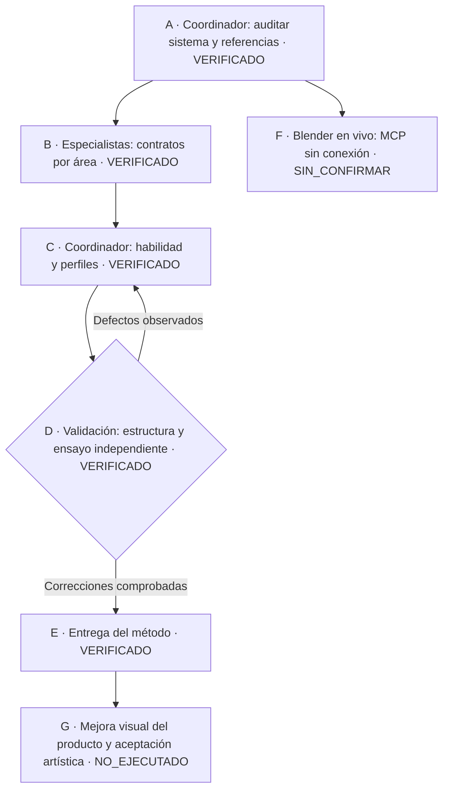

# CarWash 3D · método de producción visual

Fecha: 23-10-2026. Alcance: analizar mecanismos, crear una habilidad y especialistas reutilizables. **No se cambió la escena, los recursos, la UI o la lógica comercial en esta fase.** La evidencia del producto inspeccionada es histórica, no una nueva ejecución de navegador.

## Resultado utilizable

- Habilidad canónica: [carwash-visual-production](../.agents/skills/carwash-visual-production/SKILL.md). Instalada mediante junction en `C:/Users/estju/.codex/skills/carwash-visual-production`, sin duplicar sus instrucciones.
- Cinco perfiles persistentes en [.codex/agents](../.codex/agents): carwash_architecture, carwash_scene, carwash_blender, carwash_interaction y carwash_validation. Heredan modelo y permisos; no se modificó configuración global ni MCP.
- Contratos de tomas: [entrada, recepción, catálogo, bahía y lounge](../.agents/skills/carwash-visual-production/references/visual-contracts.md).
- [Propietarios reales](../.agents/skills/carwash-visual-production/references/project-map.md), [pipeline Blender](../.agents/skills/carwash-visual-production/references/blender-pipeline.md) y [coordinación](../.agents/skills/carwash-visual-production/references/specialists.md).
- Fuentes del usuario preservadas byte a byte: [SOW visual completo](design/visual-experience-sow.md) y [reconciliación de referencias](design/reference-reconciliation.md).

Esto conserva conocimiento mediante archivos; no entrena ni cambia los pesos del modelo. La habilidad dirige futuras sesiones hacia los dueños y criterios correctos.

## Qué explica la distancia estética actual

| Hecho observado | Consecuencia | Próximo mecanismo a verificar |
|---|---|---|
| Cámara, panel, props y arquitectura tienen parámetros repartidos | Un cambio local puede conservar clics y empeorar encuadre | Una ficha de composición por toma compartida entre esos dueños |
| [Recepción histórica](evidence/sow-closure/desktop-reception-listening.png): Ana pequeña y reloj delante del torso | El personaje no domina como en el concepto | Proyección de cara/mano/props, escala y área libre del panel |
| CounterObjects contiene cinco displays HTML | No coincide con cuatro props del nuevo SOW | Servicios → Horarios → El local → Preguntas; conservar Preparar orden en diálogo |
| `sow.spec.ts` espera cinco displays | La nueva especificación cambiará una expectativa de prueba | Actualizar prueba por cambio explícito y demostrar conservación de acciones |
| [Bahía histórica](evidence/sow-closure/desktop-active-bay.png): trabajador y coche se perciben separados | No se lee una actividad de lavado convincente | Reproducir bounds/poses/anclajes y cámara antes de atribuir causa |
| Pruebas vigentes verifican clips y acciones, no naturalidad | Un PASS funcional no demuestra saludo o agarre correctos | Video y fotogramas frontal/lateral, mano → herramienta → superficie |
| Diagnostics tiene consumidores funcionales | No puede desactivarse como mera telemetría | Documentar y preservar poses/anclas antes de separar responsabilidades |
| Exportadores pueden escribir activos y backups | Una auditoría ejecutándolos puede alterar recursos | Candidato aislado, todos los destinos inspeccionados, promoción secuencial |

La separación visual de la bahía es un síntoma de la captura inspeccionada; su causa en el runtime actual no está confirmada. No se realizó una reparación especulativa.

No hace falta cambiar de motor ni conseguir más modelos para iniciar el pulido. Hay 26 GLB existentes y cuatro categorías profesionales. El trabajo debe concentrarse primero en composición, escala humana, props cercanos y actuación. El render cinematográfico de las referencias no constituye un presupuesto viable de navegador por sí mismo.

## Arquitectura seleccionada

Extender cámara, prefabs y UI existentes, coordinados mediante fichas verificables. Un pequeño contrato compartido en el producto puede justificarse al implementar una toma para cámara + panel + pruebas; **todavía es una propuesta**, no un módulo añadido.

Se descartó crear otro motor de escenas, framework de agentes, proveedor comercial o sistema de estado. La autoridad permanece en commerceStore/proveedor y dominio operativo; cámara y animación representan datos. Una escena continua y cuatro destinos; marca configurable aunque las referencias digan FEBLES.

Los perfiles siguen el formato de [agentes personalizados documentado por OpenAI](https://learn.chatgpt.com/docs/agent-configuration/subagents). Su estructura TOML fue comprobada localmente; la herramienta de colaboración de esta sesión no permite elegir un tipo de agente por nombre. No se afirma selección automática de esos perfiles. Los especialistas de auditoría y el ensayo independiente sí fueron ejecutados mediante colaboración.

| Especialista | Propiedad | Fuera de alcance |
|---|---|---|
| Arquitectura | Dueños, contratos, dependencias, integración | Reescrituras de comercio no solicitadas |
| Escena | Cámara, layout, iluminación/materiales/vegetación | Poblar bahías ficticias o cambiar órdenes |
| Blender | Fuentes, candidatos GLB, UV, rigs, clips/anclajes | Sobrescribir .blend abierto, originales o activos durante auditoría |
| Interacción | Paneles, mostrador, navegación, teclado/touch | Otra cámara, autoridad comercial o datos inventados |
| Validación | Capturas/video, flujo, consola y métricas | Reparar producto a escondidas o aprobar arte |

Un escritor por archivo, GLB o escena Blender compartida. Se paralelizan lecturas o tareas con archivos independientes; la integración y promoción son secuenciales.

## Flujo y contrato de cambio



```text
leer petición, modo y dueños actuales
seleccionar toma + estado + acción + referencia
definir composición, área del panel, invariantes y archivos por especialista
si análisis: entregar evidencia y propuesta sin cambiar producto
si implementación autorizada: preservar baseline; ajustar dueño existente
si cambia recurso: validar candidato identificado antes de promoción
capturar navegador equivalente; revisar flujo, oclusión y actuación
conservar fallos y diferencias; separar resultado técnico de decisión artística
```

Entradas: código actual, dos especificaciones y cinco imágenes con identidad/hash. Salidas: habilidad, perfiles, contratos y evidencia del método. Invariantes: producto y datos preservados, ningún exportador ejecutado, ninguna aceptación visual inventada. Extensiones: responsabilidades por toma y perfiles específicos, sin API nueva. Rollback de esta entrega: retirar la sección nueva de AGENTS y los archivos de tooling/documentación creados; no requiere migración de producto. La junction global apunta a esta carpeta, no contiene otra copia.

## Verificaciones de esta entrega

| Comprobación | Resultado y evidencia |
|---|---|
| Identidad estática del proyecto y referencias | [Contexto](evidence/visual-method/context-before.json): 41 fuentes presentes, 26 GLB, cinco imágenes identificadas; no es validación glTF ni de calidad |
| Descubrimiento real de habilidad | [skills/list](evidence/visual-method/runtime-skill-discovery.json): nombre correcto, enabled=true y ruta canónica; una coincidencia |
| Validador skill-creator | Ejecutado con resultado `Skill is valid!`; primer intento falló por PyYAML ausente, resuelto con PyYAML 6.0.2 solo en TEMP, sin dependencia del proyecto |
| TOML y límites del colector | [Resultados](evidence/visual-method/tooling-checks.json): cinco perfiles parseados, sin override de modelo/permisos; no sobrescribe evidencia, no escribe en src, informa referencias ausentes y rechaza otro proyecto |
| Regresión del helper | [Cuatro pruebas](evidence/visual-method/collector-tests.log) ejecutadas y aprobadas en fixture aislado; reproducir con Python y `.agents/skills/carwash-visual-production/scripts/test_collect_context.py -v` |
| Preservación de producto | [63 archivos protegidos](evidence/visual-method/product-preservation.json) con hashes antes/después idénticos: dueños fuente, package/config/pruebas y 26 GLB. AGENTS y docs excluidos por ser cambios intencionales de método |
| Fuentes del usuario | Dos copias comparadas byte a byte con adjuntos originales |
| Ensayo independiente | Usó habilidad y fuentes mínimas, halló dueños correctos, no modificó producto; detectó rutas ambiguas/alcance excesivo y expectativa de cinco displays, luego revisó correcciones |
| Blender instalado | CLI respondió Blender 5.2.1 LTS; MCP no conectó con addon. No se inspeccionó ni modificó la escena abierta |
| Browser, build, E2E del producto | NOT_RUN en esta fase: no hubo cambio de producto. Resultados de SOW anteriores no se cuentan como nuevos |
| Aceptación artística | PENDIENTE |

El primer parche de creación fue rechazado por tener Delete/Add sobre el mismo archivo; no modificó archivos. Se aplicó después como Update. Se preservan estos incidentes, no se presentan como fallos del producto.

La limpieza de la caché Python generada fue rechazada por revisión automática con «blocked by policy»; se dejó en su sitio y queda excluida de versionado por el ignore de la habilidad. El observador visual reutilizó una página abierta, pero su helper de reportes respondió «No hay una consulta identificada»: el cierre del observador queda sin confirmar, sin inventar eventos o identidades. Los archivos de evidencia locales siguen disponibles.

## Cómo usarlo en el siguiente incremento

> Usa $carwash-visual-production. Implementa reception.welcome y reception.catalogue siguiendo las fuentes del proyecto. Coordina escena, interacción y Blender solo donde hagan falta; usa validación independiente. Conserva los flujos comerciales. Entrega capturas equivalentes de escritorio y móvil, saludo en secuencia y diferencias pendientes.

La habilidad queda disponible para ese trabajo. Esta entrega termina el método solicitado; no declara que el aspecto 3D ya esté corregido. Antes de expandir, completar recepción, después una bahía y luego entrada/lounge con las piezas y criterios comunes.
