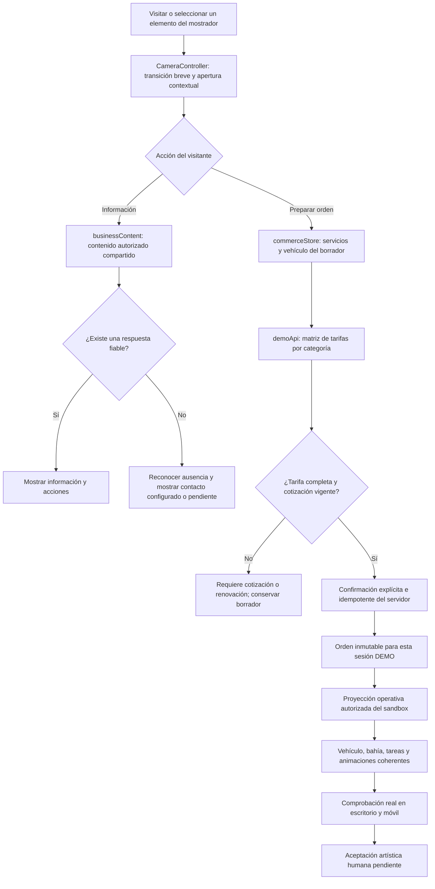

# Revisión visual actual — 23 de octubre de 2026

Estado: implementación funcional en revisión; aprobación artística pendiente. No se reconstruyó el sistema ni se restauró la aplicación descartada.

## Base y alcance

Repositorio servido: `C:\Projects\Repos\3D-Cars-Wash`, preview Vite en `http://127.0.0.1:4173/`. HEAD conservado: `6849da9c82b138b548428b179a28a990c6b9db93`. El árbol ya contenía 161 eliminaciones intencionales del proyecto anterior, cinco archivos seguidos modificados y la aplicación nueva sin seguimiento. No se hizo reset, limpieza, commit, publicación ni recuperación de esa aplicación.

Se leyeron la instrucción pegada, `AGENTS.md`, `Revision_e_Instruccion_Codex.md`, las cinco evidencias y las cinco referencias del ZIP. El ZIP quedó extraído fuera del repositorio activo, en `C:\Projects\Assets\Febles-Visual-Revision-20261023`. Se inspeccionaron también los propietarios reales de cámara, layout, animación, recursos, catálogo, cotizaciones y proyección operativa.

## Cambios y contratos

| Propietario | Cambio | Invariante |
|---|---|---|
| CameraController / layout | Recepción más cercana, FOV propio de móvil/escritorio y diálogo próximo a Ana; lounge desde la sombra | La cámara no registra llegada, pago, orden o entrega |
| Architecture / WorldLayout | Marca de pared visible en móvil, rótulo frontal reducido, mostrador con Servicios/Horarios/Preguntas; retirados carteles y exhibición redundantes | Cada acceso abre una función existente; los muebles se reflejan en obstáculos |
| EnvironmentBoundary / Landscape | Terreno principal de 100×90 a 76×66 m; perímetro cercano, palmeras y arecas nuevas, jardineras ordenadas | Carriles, bahías y áreas de observación permanecen; no escala global del mundo |
| ReceptionDialogue | Bienvenida progresiva, retorno breve, catálogo de tres tarjetas en escritorio y filas compactas en móvil | Selección y registro comparten el mismo borrador |
| businessContent / BusinessInformation | FAQ por tema explícito, proceso, condiciones, horarios y contacto sin inventar; servicios/cuidados/ofertas en lounge | No se interpreta una pregunta libre con coincidencias de palabras ni se simula una respuesta fiable |
| business-config / demoApi | Matriz servicio×categoría, versión, impuesto y descuento; validación antes de confirmar | Sin tarifa no hay orden con importe inventado; una orden confirmada conserva su cotización |
| commerceStore | Configuración obtenida del servidor; 422 distinguido de 503; catálogo público no modifica cookie privada | Borrador conservado ante fallo; confirmación solo tras respuesta del servidor |
| DemoOperationSource / VehicleAppearance | Cuatro GLB distintos; tipo/color/ID conservados; ventanilla independiente y ruedas originales | Toda animación consume tareas y posiciones; nunca las escribe |
| demoApi | Protección contra dos órdenes asignadas al mismo vehículo del mismo escenario; reinicio explícito limpia asignación sintética | No se presentan estas herramientas locales como permisos de producción |
| export-staff / NPCAnimationController | Controles correctos de Snow, muñeca y torso; pose válida al cambiar tarea con pausa | No representar bind pose como trabajo; revisar en ejecución, no solo nombres de clips |

Pseudocódigo: seleccionar destino → cancelar apertura obsoleta → trasladar cámara y abrir contexto; si información, leer el contenido común y reconocer datos ausentes; si orden, conservar borrador, solicitar precio de la categoría al servidor, rechazar faltantes/vencimiento y confirmar solo tras aceptación; consumir eventos operativos por revisión/identidad de flujo y representar sus tareas; detener efectos y herramientas de la tarea anterior. El renderer no confirma procesos comerciales.

## Recursos y procedencia

Innerscene publica los nueve recursos seleccionados como originales y CC0, gratuitamente y sin atribución obligatoria. Se conserva atribución voluntaria y URL exacta en `public/ASSET_LICENSES.txt`.

| Uso | Recurso / formato | Adaptación |
|---|---|---|
| Carro | Red four-door sedan / GLB | Orientación, pivotes y ventana; ≈4.84×2.18×1.55 m |
| Pickup | Crew-cab pickup with tonneau cover / GLB | Misma adaptación; ≈5.69×2.32×1.96 m |
| SUV | Generic compact SUV / GLB | Misma adaptación; ≈4.49×2.17×1.73 m |
| Truck | 7.5 t class box truck with roll-up door / GLB | Seis ruedas; ≈7.39×2.73×3.31 m; cola ampliada a 8.4 m entre centros |
| Vegetación | Palm detailed, Potted areca palm / GLB | Agrupado, texturas WebP 1K e instancias |
| Interior | Workshop Vac wet/dry vacuum / GLB | Tanque y boquilla original separada para la mano |
| Exterior | Spray Pump pressure sprayer / GLB | Tanque y lanza originales; representa pulverización, no una hidrolavadora industrial |
| Focos | Orbit Sand orbital sander / GLB | Herramienta orbital ilustrativa de tratamiento; no certificación de técnica o equipamiento real |

Se revisó y rechazó la familia Rgsdev CC0 por simplicidad visual. Su script de revisión escribe fuera de `public/models`, para no sobrescribir los recursos vigentes. Car Concept queda fuera de la escena activa; conserva su licencia e historial. Mature date palm se descargó como candidato, pero no se instancia.

Las tres imágenes actuales de servicios son ilustraciones generadas para el proyecto con OpenAI Image Generation. No son fotografías del local ni pruebas de la aplicación. La UI las identifica como ilustrativas. Las evidencias en `evidence/visual-revision` proceden de Playwright y del renderer real del navegador; nunca de generación de imágenes.

Pipelines canónicos: `prepare-innerscene-vehicles.py`, `pack-revision-props.mjs`, `export-staff.py` y `optimize-staff.mjs worker`. Los originales externos permanecen intactos.

## Configuración comercial honesta

`server/business-config.json` configura únicamente el sandbox local. Conserva las tarifas de carro ya existentes: exterior 3500, interior 2000 y focos 1000 centavos USD; impuesto 1150 puntos base y descuento DEMO existente para el conjunto completo. Pickup/SUV/truck tienen `null` hasta recibir importes autorizados. No se inventaron diferencias por categoría. Cambiar este archivo requiere reiniciar el proveedor local; no hay una consola administrativa de producción conectada.

El servidor valida tipo, servicios, precio, versión y vigencia antes de confirmar. No reescribe órdenes confirmadas al cambiar el borrador o la configuración.

Horarios, redes, contacto oficial y promociones están pendientes de configuración. La opción de preguntas explica esa ausencia. La consulta libre puede revisarse localmente, pero no se envía, no recopila contacto y no se guarda. No hay backend real de solicitudes de contacto; no existe botón de envío ficticio. El registro virtual sigue separado de llegada física, pago y entrega.

## Comparación visual

- Recepción: Ana pasa de un encuadre distante a cabeza/torso de aproximadamente un tercio de la altura en escritorio; diálogo cerca del tercio derecho, rostro libre y marca superior visible en móvil. La medición es estimación visual, no una certificación artística.
- Catálogo: tres tareas visibles a la vez en escritorio; imágenes de la acción en lugar del deportivo aislado. Móvil conserva imágenes breves y selección, con detalle desplegable y continuación accesible.
- Bahía: se reemplazan deportivo y bind pose por carro regular y acciones diferenciadas. Herramientas importadas asociadas a las tareas; requiere revisar el ajuste fino de manos, contacto y mangueras.
- Lounge: asientos/sombra visibles, perímetro más cercano y contenido de espera útil. Permanece una columna estructural como parte del encuadre; no se ocultó arquitectura para una captura.
- Entorno: nuevas palmeras, plantas contenidas en jardineras y menos fondo vacío. Conserva diferencias de riqueza de materiales, vegetación y acabado frente al concepto cinematográfico.

Baseline: `evidence/visual-revision/before`, más las cinco imágenes del ZIP. Las comparaciones propias usan 1440×900 y 390×844. El baseline previo no congeló todas las tareas del escenario: permite comparar composición, no igualdad exacta de datos o píxeles. La galería final fija escenario y pausa en los puntos de composición.

## Incidentes preservados

1. Candidato Rgsdev técnicamente exportable, rechazado al verlo en el navegador. Evidencia `iteration-1` y `asset-review`.
2. Exportación de candidatos Innerscene: dos aserciones detectaron nombres de neumático diferentes (truck y SUV). Contratos de nombres se inspeccionaron antes de completar la conversión; originales y logs externos conservados.
3. Primera campaña E2E: 13/15. HTTP 503 mal clasificado como conexión disponible; corregido en commerceStore. Escenario compartido avanzó antes de asignar; la asignación se rechazó correctamente y la prueba ahora reinicia/pausa el fixture y exige recibo del servidor. Logs/trazas en `failures/attempt-1`.
4. Una pose iniciada con mixer pausado podía conservar peso cero de fade-in. Se aplica pose explícita al pausar/cambiar clip; regresión ejecutada.
5. Capturas de servicio revelaron intersecciones entre cuerpo y ropa de Snow. La inspección del original mostró B-Bones con 7–14 segmentos y máscaras de autor que la conversión rígida no conservaba. Se reemplazó la conversión por articulaciones glTF con pesos de segmento y máscaras, según la API oficial de Blender. La revisión de la pose en navegador conserva ropa continua. Evidencia previa en `failures/character-before-segments`; el original previo se conserva fuera del repositorio.
6. Al revisar ojos de Snow, el GLB mostraba solo blanco. Su autor ofrece geometría de animación con regiones originales de blanco/iris/pupila. La conversión propia asignaba índices antes de vaciar los slots; Blender los reiniciaba a cero. Se guardan los índices y se aplican después de crear los slots. Prueba directa de Blender: 896 caras de blanco, 192 de iris y 128 de pupila; prueba del GLB y captura real confirman regiones visibles. Un primer smoke test esperaba tres slots exactos, pero había duplicados por tiles UV: se corrigió el contrato a tres regiones, sin cambiar el producto para forzar ese conteo.
7. Prueba nueva de picking del mostrador: primera campaña 15/16 porque sus coordenadas se tomaron con el panel abierto, pero el caso cerraba el panel y centraba la cámara. La captura demuestra el desplazamiento esperado de los rótulos. Se corrigieron las coordenadas y la espera del fixture; la campaña completa posterior pasa 16/16. La captura, video, contexto y traza fallidos permanecen en `failures/counter-fixture`, con el log `e2e-counter-fixture-attempt.log`.

## Evidencia y comprobaciones

| Comprobación ejecutada | Resultado / recibo |
|---|---|
| TypeScript + build Vite | Aprobado; bundle `index-BFu0ML46.js`, 1,478.03 kB / 426.39 kB gzip. Persiste advertencia de chunk grande |
| Vitest | 42/42, ocho archivos; `evidence/visual-revision/unit-tests-final.log` |
| Playwright, campaña completa final | 16/16 en 2.5 minutos; `evidence/visual-revision/e2e-final.log` |
| glTF Validator | 26 archivos, 0 errores, 69 advertencias; `asset-validation.json`, `asset-validation-final.log` |
| Galería y clips de servicio | Escritorio 1440×900 y móvil emulado 390×844; ambos JSON de galería registran `errors: []` |

La campaña E2E verifica las cuatro opciones de navegación, selección/registro/cotización/confirmación/recuperación/cancelación, aislamiento y CSRF, reconexión entre dos contextos, fallback de carga, foco y movimiento reducido, seis ambientes, tarifas ausentes, FAQ honesta y picking real de los tres elementos del mostrador conservando selección.

Evidencias finales en `evidence/visual-revision/final/`:

- `desktop-reception.png`, `mobile-reception.png`: composición y nombre visibles.
- `desktop-services.png`, `mobile-services.png`, `category-quotation-required.png`: catálogo y categorías.
- `desktop-registration.png`, `desktop-quote.png`, `desktop-order.png`: flujo comercial DEMO real.
- `desktop-exterior-service.png`, `desktop-interior-service.png`, `desktop-lights-service.png`, `desktop-inspection-service.png`, y equivalentes `mobile-*`: actividad y badge de la misma orden.
- `desktop-queue.png`, `desktop-lounge.png`, `desktop-lounge-content.png`, y equivalentes móviles: áreas con propósito.
- `desktop-experience.webm`, `mobile-experience.webm`: grabaciones reales del recorrido; escritorio conserva diez segundos por tarea.
- `category-wheel-motion.json`: medición real por categoría, avance/reversa/parada, con identidad y deltas de muestras conservadas.
- `build-manifest.json`: huellas de assets, bundle y recibos; verifica igualdad de GLB públicos y servidos.

Las pruebas técnicas y la revisión artística se reportan por separado. Una emulación móvil en el GPU del PC no acredita rendimiento en un teléfono físico. El backend real, autenticación/roles administrativos, pagos y persistencia durable siguen fuera de esta fase. Tampoco hay backend real de contacto ni tarifas autorizadas para las tres categorías nuevas. Se mantiene el gate de aceptación artística abierto.

## Rendimiento observado y límites de aceptación

Edge headless / Intel UHD / ANGLE Direct3D11, 1440×900, ventana de 180 frames con la escena activa. Recibos `final/metrics-quiet.json` y `final/metrics-busy.json`.

| Escenario | FPS medios | P95 frame | Draw calls | Triángulos | Texturas |
|---|---:|---:|---:|---:|---:|
| Quiet | 39.8 | 26.6 ms | 1,139 | 4,238,242 | 129 |
| Busy | 27.2 | 41.2 ms | 1,708 | 6,120,992 | 295 |

Carga observada: quiet 8.27 s y busy 3.08 s en el mismo equipo; no representan una comparación de cargas frías de red. Memoria GPU no disponible. La navegación a recepción se midió en 1,355 ms y la propagación de un comando DEMO entre dos contextos en 279 ms; ambos son localhost y una sola campaña, no SLA de producción.

La prueba adicional de cuatro categorías observó 100 muestras en 33.39 s, con avance, reversa y ruedas congeladas tras pausa; sin errores de página. Los ejemplos guardan el ID real de la entidad de cada muestra, no solo un ID representativo de la categoría.

El caso busy requiere más optimización antes de prometer fluidez en hardware móvil. No se promete 60 FPS. Conservar segmentos y ropa de Snow añade articulaciones; eliminar esa deformación para reducir peso reintroduciría el defecto demostrado. Faltan validación en teléfono físico, afinación de agarres/contacto/mangueras y aprobación visual humana. No se realizaron compras ni publicación externa.

## Refinamiento de composición y controles — 23-10-2026

Esta iteración responde a la revisión de ambiente, iconografía y cierre UX. El nombre visible ahora procede de `VITE_CARWASH_NAME` y usa `CarWash Studio` como valor genérico; el título HTML y los textos públicos ya no dependen de Febles.

Cambios observables:

- Se añadió la imagen suministrada en `public/textures/site-background.png` como fondo ambiental lejano. La iluminación HDR, el suelo y los modelos continúan siendo 3D; la imagen no reemplaza las superficies transitables.
- La cámara de recepción se alejó a un punto de observación de 4.2 m y las cámaras de las bahías se desplazaron detrás del carril peatonal. Esto deja vehículo, trabajador y actividad dentro del encuadre sin el poste frontal dominando la escena.
- `VehicleAppearance` limita cada categoría a 6.15 m de largo, 2.52 m de ancho y 2.35 m de alto, manteniendo el radio de rueda corregido por la misma escala. El truck queda por debajo del techo.
- Se añadieron marcas de carril, franjas de separación, cruce peatonal y rótulo `CAMINO PEATONAL` en el suelo.
- Los tres soportes del mostrador tienen hitbox frontal independiente y un equivalente accesible invisible en escritorio para que `Servicios`, `Horarios` y `Preguntas` reciban el mismo comando aunque el panel se cierre.
- El HUD mantiene siempre `Mi orden`, `Cómo funciona`, avatar y ayuda. El avatar abre un popover de cuenta DEMO con vehículo, historial y salida explícita; el timeline se abre como modal centrado siguiendo la estructura visual de Flowbite.
- La recepcionista usa el clip completo `Greet` una sola vez y después pasa a `Idle`; se eliminó el bucle `Talk` que repetía una mano aislada.
- Las plantas del mostrador se movieron al perímetro; las bahías siguen mostrando solo vehículos del `DemoOperationSource`, cada uno con estado, tareas y trabajador asignado cuando corresponde.

Evidencia nueva: `evidence/visual-revision/current-reception-2.png` y `evidence/visual-revision/current-bay.png`. La consola del navegador registró cero errores y una advertencia de deprecación de `THREE.Clock` del runtime.

Validación de esta iteración: build Vite y 42 pruebas unitarias aprobadas; picking de mostrador 1/1 y cancelación rechazada 1/1 aprobados; cuenta y timeline comprobados mediante snapshot de Playwright. La campaña completa posterior al cambio de marca queda pendiente de cerrar: el intento se detuvo en la prueba de fallo de red por un botón que se desprendió durante el re-render (`Reintentar conexión`), antes de completar los 16 casos.

## Seguimiento local

El informe y los recibos están guardados en el repositorio. Al cerrar, el helper del panel Visual Agent Live devolvió «No hay una consulta identificada» para la sesión real; relanzarlo tampoco encontró una consulta observada. No se inventó un turno ni se atribuyeron recibos de otra consulta. El cierre del observador queda sin confirmar; esto no sustituye ni invalida los logs de ejecución conservados del producto.
