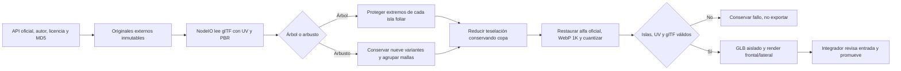

# Vegetación de entrada — candidatos aislados

Preparación observada el 23-10-2026. No se modificaron `src/`, `public/`, servidores del producto ni la sesión Blender del usuario. El integrador conserva la promoción y validación dentro de la entrada. La aceptación artística humana sigue pendiente.

| Candidato externo | Triángulos | Bytes | Dimensiones X/Y/Z, m | glTF errores/avisos |
|---|---:|---:|---|---|
| `urbanTree-v3.glb` | 206 616 | 9 479 644 | 2.917 / 4.557 / 4.292 | 0 / 3 |
| `urbanTreeFar-v1.glb` | 38 697 | 4 136 576 | 2.916 / 4.557 / 4.292 | 0 / 3 |
| `urbanShrub-v5.glb` | 30 905 | 1 172 708 | .387 / .379 / .395 | 0 / 1 |

Directorio: `C:/Projects/Assets/CarWash-Entrance-Urban-20261023/candidates`. Cada GLB tiene manifiesto completo `.glb.json` con SHA-256, fuentes descargadas, MD5 oficial, versiones, receta, geometría, UV, materiales, texturas, dimensiones y validación. `vegetation-candidates.json` conserva una verificación independiente posterior de los tres finales.

Fuentes: [Tree Small 02](https://polyhaven.com/a/tree_small_02) y [Shrub 01](https://polyhaven.com/a/shrub_01), ambos de Rico Cilliers. [Licencia oficial Poly Haven: CC0](https://polyhaven.com/license). Se verificaron las API oficiales `/info/{id}` y `/files/{id}`; las descargas preservan la organización glTF + BIN + texturas externas originales y se leen con `NodeIO`. No se usa el modelo `island_tree_02` rechazado.

## Contrato y mecanismo



```text
leer receta y destinos externos; rechazar public/repositorio y candidatos existentes
verificar o descargar fuente oficial y todos sus includes mediante MD5
leer glTF original; rechazar rigs/clips inesperados
para cada primitiva:
    conservar conjunto UV usado por su material
    proteger extremos de cada isla foliar; reducir teselación con error acotado
    rechazar si quedan menos del 99% de componentes foliares
restaurar PNG alfa oficial sobre diffuse JPEG del glTF
si arbusto: reagrupar nueve variantes reales, apoyar al suelo y fusionar mallas
cuantizar, embeber texturas WebP y validar antes de exportar
escribir candidato nuevo + manifiesto; renderizar con navegador independiente
```

El glTF oficial de ambos recursos usa diffuse JPEG, sin el alfa de hojas que sí está disponible en la API. Se compone el mapa PNG alfa oficial sobre diffuse y se usa `MASK .5`; no se falsea la densidad mediante tarjetas opacas. Se conservan UV usados, normales, PBR, doble cara y transformaciones de textura de ramas. Se eliminan solamente conjuntos UV duplicados que ningún material utiliza. No hacen falta decodificadores Meshopt/Draco.

Árbol cercano: bloqueo de seis extremos por isla; 30 250 componentes originales → 31 435 después de simplificar, porque algunas conexiones se separan. Árbol de fondo: protección de longitud y anchura por isla, 30 250 → 30 089 componentes (99.47%). Su forma de hoja simplificada se nota de cerca; utilizarlo únicamente detrás del establecimiento, comprobar separación de ramas en la toma y recorrido. Los conteos no sustituyen inspección visual.

Arbusto: la fuente trae nueve variantes herbáceas en fila, no un arbusto podado. Se conservaron todas, se reagruparon con giros y escalas suaves, se apoyaron al suelo y se fusionaron en una sola malla/material para evitar nueve draw calls por instancia. El aspecto mantiene flores blancas pequeñas y tallos reconocibles. No es equivalencia exacta a un seto ornamental de la referencia. Escala uniforme 1.4 da aproximadamente .53 m de alto y .55 m de ancho; el integrador debe revisar densidad y contacto con jardinera.

## Reproducción

Usar nombres nuevos para no sobrescribir candidatos ni evidencia existente:

```powershell
node scripts/prepare-urban-vegetation.mjs tree_small_02 C:/Projects/Assets/CarWash-Entrance-Urban-20261023 C:/Projects/Assets/CarWash-Entrance-Urban-20261023/candidates/urbanTree-review.glb --preview
node scripts/prepare-urban-vegetation.mjs tree_small_02 C:/Projects/Assets/CarWash-Entrance-Urban-20261023 C:/Projects/Assets/CarWash-Entrance-Urban-20261023/candidates/urbanTreeFar-review.glb --far --preview
node scripts/prepare-urban-vegetation.mjs shrub_01 C:/Projects/Assets/CarWash-Entrance-Urban-20261023 C:/Projects/Assets/CarWash-Entrance-Urban-20261023/candidates/urbanShrub-review.glb --preview
```

Dependencias existentes: glTF Transform 4.5.1, Meshoptimizer, Sharp y glTF Validator; no se instalaron librerías. El preview abre su propio navegador Edge headless y un servidor HTTP efímero aislado; se cierran al terminar y no comparten las páginas de pruebas del integrador.

## Comprobaciones ejecutadas

- Sintaxis `node --check`: correcta.
- Lectura independiente posterior de los tres GLB con NodeIO: correcta; 0 skins, 0 clips y todas las referencias UV presentes.
- Integridad SHA-256 de todas las fuentes leídas: coincide con manifiestos; descarga inicial también cotejada con MD5 oficial.
- glTF Validator repetido sobre los bytes finales: 0 errores; avisos 3/3/1 por espacio tangente generado en runtime, conservados en manifiestos. No se ocultaron avisos ni añadieron tangentes inventadas.
- Rechazo efectivo de salida dentro de `public/models` y de sobrescritura de candidato existente: observado.
- Renders reales frontales/laterales a 900×900 con cámara ortográfica y misma luz: 0 errores de página. Los archivos `vegetation-urbanTree-v3-*`, `vegetation-urbanTreeFar-v1-*` y `vegetation-urbanShrub-v5-*` corresponden a los finales. Son inspecciones de recurso, no pruebas de composición de entrada.
- Tiempos observados de preparación hasta validación/exportación, excluyendo preview: árbol cercano 4.926 s; árbol fondo 5.716 s; arbusto final .647 s. Los manifiestos conservan UTC de inicio/fin.
- No se ejecutaron tests/build/E2E del producto para este trabajo aislado de candidatos; pertenecen a la integración de la entrada.

## Intentos y límites conservados

- `vegetation-attempt-1.json`: simplificación global rechazada por perder 1.51% de islas foliares antes de exportar. Se sustituyó por extremos protegidos.
- Primer árbol conservador válido: 1.66 M triángulos / 51 MB. No recomendado; permanece externo como baseline de revisión.
- `vegetation-shrub-attempt-1.json`: agrupación inicial con centros de tallo del espacio equivocado produjo dos grupos vacíos, 12 errores de validación y no se exportó. La agrupación actual usa centros locales observados y rechaza grupos vacíos.
- Árboles finales mantienen el origen fuente: mínimo Y ≈ −.024 m. Apoyar mediante bounds/normalización existente al instanciar; no sumar un segundo ajuste arbitrario.
- Pendiente: promoción por integrador, escala/contacto en jardineras, aspecto bajo luz real, FPS/coste de sombras en móviles y comparación con la referencia a 1855×848.
