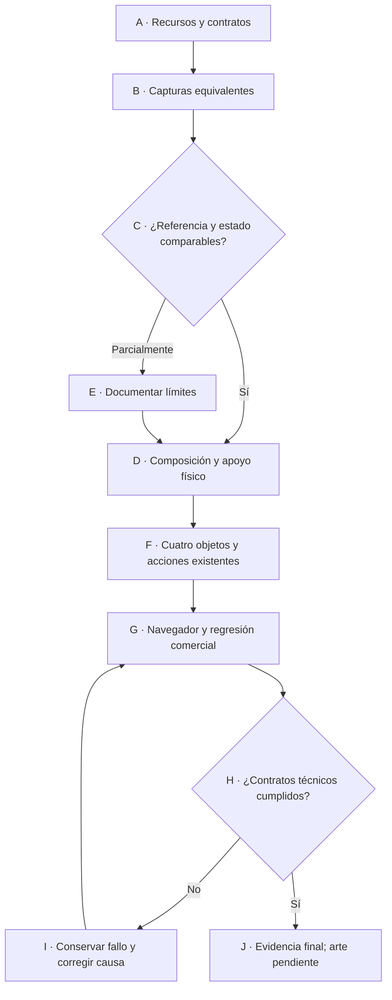

# Piloto de entrada y recepción · 23-10-2026

## Alcance y auditoría

Entrega solicitada: aplicar los recursos existentes al establecimiento interactivo, conservar operación y completar una zona piloto. La API actual es un sandbox local; las pruebas no certifican administración, identidad ni pagos de producción.

| Recurso comprobado | Responsabilidad | Brecha y decisión |
|---|---|---|
| `AGENTS.md` del repositorio | Stack, permisos, privacidad y operación | Conservar la migración sin confirmar y los recursos profesionales vigentes. |
| `.agents/skills/carwash-visual-production/SKILL.md` y copia global | Contratos de escena y evidencia | Aplicados con sus referencias; la escena inicial tenía cinco displays frente a los cuatro props del SOW. |
| `.codex/agents/carwash_*.toml` | Arquitectura, escena, Blender, interacción, validación | Se leyeron y pasaron manualmente a subagentes; no se afirma registro automático. |
| `docs/design/visual-experience-sow.md` y `reference-reconciliation.md` | Una escena y cinco vistas | Usados como contratos; no copiar diferencias de marca/nav de los conceptos. |
| `service-world-3d` | Seis responsabilidades declaradas en el texto recibido | No localizado en catálogo, skills, adjuntos o repositorio. No se inventaron instrucciones ni se creó sustituto. Su reconciliación literal queda pendiente. |
| UI Pro Max | Controles, foco, tipografía y acceso | Apoyo del especialista de interacción; la dirección espacial sigue el SOW. |

Distribución de responsabilidades sin duplicar perfiles: dirección del mundo = coordinador; escena/ambiente = perfil scene; personajes/movimiento = perfil blender; operación/sincronización = architecture; UX espacial = interaction; evidencia independiente = validation. Blender se auditó por archivos; no se operó la sesión viva ni se exportaron GLB.

El mapa local `references/project-map.md` se actualizó al dueño real de paisaje y a los cuatro props/pruebas actuales. `references/specialists.md` documenta la asignación de las seis responsabilidades a los cinco perfiles y coordinador existentes, el límite de UI Pro Max y la cola compartida de build/navegador. No se creó otro skill, framework ni registro automático de agentes. La copia global del skill no se modificó: el AGENTS del proyecto selecciona expresamente esta versión local.

La revisión independiente detectó otros desajustes y se corrigieron: `carwash_scene.toml` nombra ahora los nuevos dueños; `collect_context.py` añade paisaje, entrada, lounge y su suite a la lista pública permitida; `AGENTS.md` enumera las tres suites que ya ejecuta Playwright. Los cuatro tests Python del helper pasaron; `context-final.json` identifica 46 propietarios sin ausencias, 35 GLB y cinco referencias. Se preservan los recibos anteriores de 41 propietarios, que no incluían los módulos nuevos. Estas correcciones de método no cambian producto, API o bundle.

## Propietarios y contrato

| Nodo | Dueño/archivos | Invariante y comprobación |
|---|---|---|
| A | Coordinador y auditor architecture | Auditar antes de editar; `context-before.json` identifica propietarios, modelos y referencias por hash. |
| B/C | `scripts/capture-pilot.mjs` | Capturas reales anónimas con operación vacía; 1855×848, 1440×900, 650×900 y 390×844. |
| D | Coordinación con el dueño de `siteLandscape.ts` / `prefabs/Landscape.tsx`; límite en `navigation/layout.ts` | Las bases derivan de la tierra de `loungeRear`; ruta de cámara excluye el volumen de la jardinera. |
| F | Especialista interaction: `CounterObjects.tsx`, reglas `.counter-*` de `sow.css` | Cuatro props, centro libre, controles nativos y mismos pasos del borrador; ninguna orden o estado cambia por animación. |
| G/H | Especialista independiente validation: E2E commercial/sow | Cuatro objetos, targets reales, teclado, conservación del borrador y regresión comercial. |

Algoritmo: preservar fuente y capturas iniciales; leer referencias y estado; ajustar sólo los dueños asignados; representar datos del proveedor sin mutarlos; comprobar interacción y límites físicos; compilar y ejecutar suites; conservar antes/después, errores y diferencias. El rollback es el diff puntual de esta entrega, nunca reset del árbol preexistente.

## Referencias y comparación

Originales en `C:/Users/estju/Downloads/`; nombres, tamaños y SHA-256 en `context-before.json`. Se inspeccionaron entrada, recepción y lounge. Observado: cubiertas rojo/grafito, acera clara, plataforma de madera, jardineras bajas, copas irregulares, mostrador con centro libre y panel lateral. Decisión de este piloto: sostener físicamente árbol/arbustos existentes y sustituir tarjetas por cuatro props; no reconstruir el establecimiento ni cambiar tarifas.

La baseline se compiló antes de capturar. `before/capture.json` conserva bundle, viewport, estado, cámara, clima y consola; screenshots y videos están en `before/`. Luz soleada simulada después de 100 frames, recepción en Idle. Nubes y fase exacta Idle no están congeladas: comparación aproximada en esos detalles.

Límite observado: el build concurrente cambió la entrada JS durante la baseline. Las capturas de 1855/1440 cargaron `index-BPiWgbIX.js`; las de 650/390 cargaron `index-tzJPLZKH.js`. No constituyen una única versión inicial. Se conservan ambas y las comparaciones se atribuyen por viewport/bundle. El capturador final comprueba identidad del build y falla si cambia.

Contrato de cámara de recepción: posición X/Z `[-6.45,7.4]`, ojo 1,66 m; FOV escritorio 49° conservado. Para anchos ≤700 px, el dueño de cámara amplió FOV de 61° a 98° para ver los cuatro props en sus posiciones físicas, sin recolocarlos por viewport. Es una diferencia intencionada que debe considerarse al comparar móvil. La entrada conserva FOV 66° escritorio / 72° móvil. Nubes y fase exacta del Idle siguen siendo variables.

## Trabajo concurrente preservado

Durante la baseline otro chat cambió vegetación en `Architecture.tsx`, `EnvironmentBoundary.tsx` y `EntranceForecourt.tsx`. El usuario confirmó esa concurrencia y autorizó coordinar sin sobrescribir. Se acordaron propietarios con «Rediseñar tienda 3D de lavado» y «Corregir vegetación y asientos», comprobando las autorizaciones humanas de coordinación. El primero conserva cámara, muebles y build; el segundo concentra vegetación en `siteLandscape.ts`/`prefabs/Landscape.tsx` e integra la jardinera trasera de este piloto con altura de raíces derivada del suelo, sin bloques duplicados. Este equipo conserva mostrador, controles y QA de cuatro props, más el límite físico trasero en navegación. Los cambios de GLB/tintes, nuevos muebles, reglas generales de plantación y API de los otros chats no se atribuyen a este equipo. La diferencia visual total antes/después incluye ese trabajo concurrente.

La migración previa del árbol Git, con numerosas eliminaciones y archivos nuevos, se mantuvo. `source-before/` guarda cinco archivos de presentación como evidencia de la baseline, no como autorización para restaurarlos sobre cambios concurrentes.

En el intento 3 se identificó un cuarto frente: el chat del diagnóstico UX confirmó autoría de títulos por etapa, scroll/foco de paneles, selector de El local, nombre del lounge y consulta del vehículo sin mover la cámara cuando no existe entidad propia. También confirmó haber iniciado Vite DEV en 4173 a las 21:40 y compilado mientras corría QA. Los cambios se preservaron y se acordó congelación explícita y un solo escritor de las tres suites. El chat «Mejora el aspecto visual» fue contactado para coordinar acabados; no se le atribuyen cambios concretos sin su confirmación.

Ambos chats confirmaron después la congelación de fuente, build, servidor y GPU para el cierre. «Mejora el aspecto visual» recibió una nueva solicitud humana de revisar plantas apoyadas sobre el suelo y el carácter de árboles/texturas; acordó preparar candidatos aislados sin promoverlos hasta liberar la ventana. Esa revisión posterior no forma parte de la evidencia de este piloto. `context-frozen.json` conserva las identidades de 46 propietarios, 35 modelos y cinco referencias durante la revisión congelada.

## Evidencia y pendientes

- Baseline: `npm test`, 10 archivos / 49 pruebas; `npm run build` correcto, con advertencia de chunk grande existente.
- Después de añadir jardinera/obstáculo: 10 archivos / 49 pruebas unitarias correctas.
- Build integrado previo al intento 3: `index-B2s8vlTf.js`, CSS `index-BKCWPNlH.css`. `../vegetation-coherence/build-final-integrated.log` acredita compilación correcta; `unit-final-integrated.log` registra 12 archivos / 59 pruebas aprobadas a las 21:41:24 del 23-10-2026 (America/La_Paz). El dueño externo ejecutó ambos; este equipo inspeccionó los logs. No acreditan por sí solos el runtime servido: el intento 3 detectó DEV y cambios concurrentes posteriores.
- Integración de los otros chats: 11 archivos / 55 pruebas unitarias correctas (`../site-zones-lounge/unit-final.log`, observado 20:40). Incluye comprobaciones de raíces/GLB y raycast de superficie visible. La muestra integrada previa mostró tierra oculta por una tapa maciza: se corrigió en el dueño de paisaje mediante paredes huecas; no se ocultó ese fallo detrás del resultado de coordenadas. Las capturas previas están en `../vegetation-coherence/integrated-preview/` y no son la evidencia visual final.
- Pendiente detectado por lectura, no reproducido: `StaffPrefab` y `ServiceActivityVisualizer` consultan `paused` pero no `sync`; el HUD avisa datos sin actualizar, mientras trabajadores/agua podrían continuar. No se alteró ese mecanismo en el piloto.
- La equivalencia fotográfica, el resto de zonas y la aprobación artística humana no se acreditan por compilar ni pasar E2E.
- Revisión React/mantenibilidad del mostrador: helpers privados cohesionados en el mismo componente, hooks estables, rAF de retorno de foco cancelable, controles nativos con nombre accesible, y las mismas acciones del store comercial. Se reutilizan fuente e imagen existentes, sin dependencias nuevas. La comprobación TypeScript sin emisión y la sintaxis Node del capturador pasaron. `package.json` no define comandos independientes de lint o formato; no se afirma haberlos ejecutado.

## Intentos de navegador conservados

1. `attempt-1/targeted.log`: seis casos, cuatro aprobados y dos fallidos (3,2 min). Pasaron 1855×848, 650×900, 390×844 y teclado/foco/selección. El caso de 1440×900 devolvió `43.999969482421875` px de alto ante un límite literal de 44 px; se conserva su captura y medición para corregir la precisión del arnés sin reducir el tamaño CSS requerido. El flujo comercial alcanzó el último retorno al catálogo con el servicio seleccionado, pero agotó 90 s; se conserva trace, video y contexto, y se analizan sus tiempos antes de repetirlo. No se atribuye PASS a ninguno de esos dos casos en este intento.

Diagnóstico del primer intento: la traza contabiliza 52,18 s de carga inicial y acciones posteriores de 0,99–3,52 s completadas. El último clic recibió input y devolvió el catálogo con selección; no se observó una espera por oclusión. Ajuste del arnés: 150 s sólo para este flujo largo; tolerancia DOMRect de 0,01 px con mínimos CSS ≥44 px comprobados estrictamente. No hubo cambio de producto para esas incidencias.

2. `attempt-2/targeted.log`, `exit-code.txt`: repetición de los dos casos afectados, ambos aprobados, exit 0 (2,1 min). El flujo completo tardó 1,6 min y el caso 1440×900, 24,3 s. La captura/JSON de 1440 confirma controles sin solapamiento, centros accesibles, mínimos CSS 112×44 px y cero errores. Los otros cuatro casos aprobados permanecen en el intento 1. Mismo entry `index-Ds3b6eNw.js`; sin cambios de producto entre intentos.

Condiciones: durante parte del intento 2 se solapó el capturador de paisaje de otro chat por señales de coordinación cruzadas. Se conservaron ambas ejecuciones; no se atribuyen exclusividad de GPU, mejora de FPS ni tiempos representativos de usuarios reales. La suite completa se coordina en una única cola sin capturas simultáneas. La carga fría de 52,18 s del primer trace es una observación del entorno de prueba, no un presupuesto de rendimiento aprobado.

3. Suite integrada del otro chat: `../vegetation-coherence/e2e-integrated.log`, 30 aprobados y un fallo entre 31 casos (17,2 min). El fallo del lounge era el selector `getByLabel('Color', exact:true)`: la evidencia mostraba el formulario y Azul seleccionado. Se conservó el fallo y se cambió el selector al combobox de nombre Color, manteniendo las aserciones de borrador y ausencia de orden. Se observó un nuevo bundle durante el intervalo de la tanda; por ello esta suite se conserva como cobertura de integración de varias versiones, sin afirmar que todos sus casos corrieron sobre una sola revisión. El cierre posterior usa un build fijado, 11 casos pertinentes y una captura con hashes estables.

4. `attempt-3/targeted.log`: 11 casos, seis aprobados y cinco fallidos (7,2 min), test exit 1 y guard exit 2. Los fallos observaron expectativas anteriores de título/navegación/información del lounge y recepción. No acreditan un defecto de operación: `runtime-guard.json` y `served-index-observed.html` demostraron que 4173 servía DEV con `/@react-refresh`, y el watcher registró otro build entre 21:47:55–21:47:56 (`index-B2s8vlTf.js` → `index-FXtXVk5r.js`). Los manifests difieren. Se rechaza la atribución del intento a un build congelado, incluidos sus casos aprobados. Los navegadores del runner cerraron; se preservó Edge visible ajeno. La siguiente tanda comprobará el HTML realmente servido y los scripts cargados, además de los hashes de disco. El capturador falla antes de abrir navegador si el servidor no sirve el entry esperado.

5. **Cierre funcional del piloto:** `attempt-4/targeted.log`, 11/11 aprobados en 4,1 min, exit 0. Preview 4173 sirvió `index-FXtXVk5r.js` y CSS `index-BUVGw9qR.css`. `bundle-guard.json` registra manifests iguales, cero eventos y HTTP válido antes/después; los ocho recursos HTML/JS/CSS servidos coincidieron por SHA-256 con disco. `browser-closure.json` documenta cierre del runner y preservación de los procesos del Edge visible del usuario. No hubo otra tanda GPU en paralelo.

La revisión congelada se compiló correctamente y aprobó 59/59 pruebas unitarias, 12 archivos, a las 21:51:45 (`../vegetation-coherence/build-frozen-final.log`, `unit-frozen-final.log`); se conserva la advertencia de chunk mayor de 1100 kB. El otro integrador guardó `../vegetation-coherence/source-FXtXVk5r.zip` antes de liberar sólo fuente TSX para el siguiente incremento. El build servido, modelos, API/configuración, suites y cola GPU siguieron congelados para las capturas. Este cierre acredita esa revisión, sin extender el resultado a ediciones posteriores del árbol compartido.

Los once casos cubren las cuatro funciones del mostrador, selección y retorno al borrador, cuatro resoluciones, targets de al menos 44 px sin solapamiento ni oclusión central, Tab/Enter/Escape y retorno de foco, información del lounge, servicios con inclusiones visibles, ausencia de orden al recuperar borrador, llegada pendiente/atención/listo, último estado al perder red y reconexión. En móvil, consultar un vehículo inexistente mantiene la cámara en lounge y no sustituye una entidad ajena. Las expectativas UX se adaptaron al contrato humano actual; no se quitaron las comprobaciones de Azul, servicios, orden nula, privacidad o sincronización.

**Límite de regresión:** la suite completa de 31 casos no se volvió a ejecutar sobre esta última UX. Persisten expectativas antiguas fuera de los once casos pertinentes en las suites históricas; el chat del diagnóstico conserva su siguiente fase de pruebas. No se declara 31/31 ni cobertura completa de la operación sobre este build.

## Ajuste final de significado de la animación

La inspección independiente encontró que `PointOrder` fue diseñado para señalar la antigua terminal (fuentes `scripts/export-staff.py` y este inventario de recursos). Su lugar lo ocupa ahora el folleto del local. Se mantuvieron los GLB y el controlador; `StaffPrefab` selecciona `PointServices` sólo al mostrar servicios. Vehículo, revisión e información usan `Talk` una vez y vuelven a `Idle`. Trabajadores, reduced motion, saludo y reglas comerciales mantienen su comportamiento. No se afirma que el rayo de la mano intersecara exactamente el folleto: se corrigió el significado obsoleto demostrado por las fuentes.

El caso de Ana pasó sobre el preview congelado: saludo, señalamiento de servicios y `Talk → Idle` en las tres etapas, cotizando sin confirmar ni crear una orden. `attempt-4/e2e-sow/reception-explanations.json` registra `Talk` a 0,218 s (vehículo), 0,213 s (revisión) y 0,224 s (información), seguidos de `Idle` comprobado por la prueba. El JSON advierte que la animación continúa durante el screenshot. La prueba comprueba clip/tiempo, no certifica naturalidad artística.

## Lectura visual y límites de aceptación

La tanda visual final terminó a las 22:00:27 del 23-10-2026 (America/La_Paz): `after/capture.json` registra navegador real, cuatro resoluciones (1855×848, 1440×900, 650×900, 390×844), 16 PNG y cuatro videos de navegación. Cero errores de navegador y cero vehículos en la entrada anónima de las cuatro visitas. Los 43 hashes de HTML, JS/CSS y modelos **servidos desde dist** permanecieron iguales antes/después; el entry cargado fue `index-FXtXVk5r.js` en los cuatro contextos. No se alteraron datos para imitar coches del concepto.

`comparison.html` enlaza referencia/antes/después de escritorio y comparación móvil. `artifact-check.json` comprueba los 28 enlaces locales sin ausencias, dimensiones PNG y existencia de los cuatro videos; es una comprobación de archivos/metadatos, no otro E2E ni una aprobación de arte. En escritorio los controles medidos son 112×44 px, y a 650/390 px, 64×44 px (con el redondeo DOMRect documentado). Los videos conservan transiciones reales de cámara; no prueban ruedas, agarres o herramientas de una operación que esta visita vacía no ejecutó.

Las capturas reales de escritorio muestran cuatro objetos físicos con perfiles distintos y el centro delante de Ana despejado. El reloj tiene esfera y manecillas; el catálogo reutiliza la imagen de servicio existente; folleto y tableta tienen bases propias. Recepción, lounge y bahías comparten estructura roja/grafito, suelo y mobiliario; la entrada sigue vacía porque no hay operación registrada para esa visita. Las jardineras integradas sostienen las bases y quedan fuera del recorrido probado.

Esto no equivale al concepto aprobado: Ana queda pequeña respecto al mostrador y al reloj/folleto; el móvil usa un encuadre muy amplio con bastante pavimento. Los arbustos siguen bajos y poco densos, las copas y la corteza tienen un carácter más geométrico, y el suelo de las jardineras ofrece poco contraste. El fondo montañoso difiere del urbano. La dirección/intensidad de sombras, acabados y proporciones no se certifican por la prueba funcional. La siguiente fase visual de otros chats revisa parte de esas diferencias y debe producir nueva evidencia.

El veredicto de este incremento es **piloto técnico verificado, aceptación artística pendiente**. El skill `service-world-3d` continúa sin localizarse y su reconciliación literal queda pendiente; sí se aplicaron y actualizaron los recursos existentes documentados. El resto del establecimiento y la hipótesis de animaciones durante datos obsoletos quedan fuera del cierre comprobado. No se afirma que toda la solicitud de mundo completo esté terminada.

## Cierre del observador

`structured-result.json` conserva el reporte seguro con veredicto parcial y las comprobaciones efectivas. El helper de Visual Agent Live rechazó su registro con «No hay una consulta identificada» para la sesión real; el reintento del launcher respondió «Todavía no hay una consulta observada para atribuir este objetivo». No se inventó otra consulta ni evidencia para forzar el cierre. El registro durable del dashboard queda sin confirmar; esta limitación del observador no sustituye ni invalida los logs y artefactos de producto enlazados aquí.
