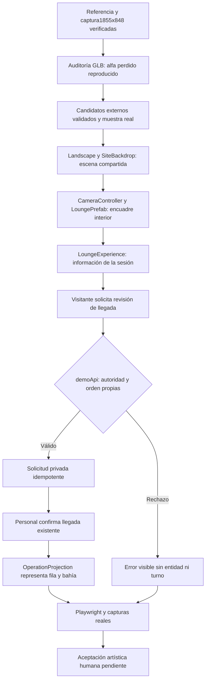

# Integración de entrada, vegetación, fondo, lounge y llegada

23-10-2026, America/La_Paz. Los registros UTC de esta tanda cruzan al24-10. Repositorio existente conservado; sin commits, compras, dependencias nuevas ni recuperación del diseño descartado.

## Resultado y causa del fondo ausente

El fondo no falló al descargar. El componente anterior que cargaba site-background.png se había retirado al sustituir el entorno por UrbanSurround. La instrucción anterior permitía eliminar la montaña, pero la petición posterior manda conservar la imagen suministrada. Se restauró explícitamente en SiteBackdrop, separada de HDRI y del mundo transitable. Una esfera envolvente con sectores reflejados y transición superior evita bordes de planos; no se afirma que una foto rectangular sea un panorama360 ni geometría urbana con parallax. La imagen original permanece intacta.

La entrada conserva asfalto mate sin cuadrícula, acera clara y plataforma de madera. El lounge ahora tiene marcos oscuros con listones, cojines beige con bordes suavizados, acento rojo, mesa baja de madera y maceta. La cámara está dentro de la cubierta a1.25m: destino[-13.6,10], mirada[-1,-1.5], FOV vertical55 escritorio. El encuadre móvil prioriza sofá, mesa/maceta y recepción. La recepción móvil usa FOV98 para los cuatro objetos físicos distribuidos en su ancho; no se comprimen ni mueven modelos por viewport.

## Materiales y vegetación

La [auditoría de recursos](REPORT.md) verificó sRGB en albedo, mapas de datos lineales y metalness0. La pérdida de alfa del empaquetado fue reproducida: un pipeline Sharp removeAlpha/joinChannel eliminaba el canal incorporado. La corrección separa las operaciones y rechaza salidas sin transparencia real. glTF Validator por sí solo no detectaba este fallo visual. Se preservan sus afirmaciones anteriores rectificadas, candidatos fallidos y fuentes.

Primero se capturó una muestra de un árbol y una jardinera, a la cámara/exposición original. Jacaranda se descartó porque su render seguía abierto. La muestra elegida conserva9450hojas malladas de un roble InnersceneCC0; su reparto60/30/10 se aplica sólo a los materiales sin textura. Los arbustos usan variantes moderadas que conservan la variación de sus mapas; Calathea aporta hojas amplias. Se extendió esa familia a las zonas definidas tras revisar la muestra. Aceptación artística humana pendiente: el roble conserva corteza lisa y el arbusto flores pequeñas.

El trabajo coordinado de paisaje estableció un único dueño siteLandscape y superficies compartidas de cuatro paredes con tierra visible. Las raíces y el suelo derivan de la misma altura; pruebas con vértices GLB reales, rayos contra las superficies y barrido OBB del truck comprueban soporte y circulación. Se retiraron plantas del carril trasero y se ajustó la jardinera de primer plano para el giro del truck. Ver [informe de suelo y asiento](../site-zones-lounge/REPORT.md).

## Lounge y llegada: comportamiento comercial

LoungeExperience consume la orden de su sesión y exclusivamente su worldEntityId. Sin orden ofrece preparar; llegada pendiente no presume vehículo en servicio; atención muestra tarea/bahía/turno proporcionados; listo muestra siguientes pasos; reconexión mantiene último estado identificado. Tarjetas de cuidados/ofertas/información usan contenido configurado y vistas internas con Volver. No se inventan promociones, horarios, contacto ni clientes.

POST /api/demo/arrival-request permite solicitar revisión de presencia. Requiere cookie/nonce/Origin y orden propia confirmed/not-arrived; es idempotente. Conserva attention=not-arrived, worldEntityId=null y pago pendiente. Sólo el comando administrativo arrive crea la entidad y el turno. La solicitud privada sobrevive recarga durante el proceso local y aparece al personal. No es verificación geográfica ni cobro. El preview local se reinició para activar esta API; las órdenes de este sandbox son en memoria, no persistencia de producción. Contrato: [LOCAL_API_CONTRACTS](../../LOCAL_API_CONTRACTS.md).

## Flujo de propietarios y verificación

Cámara, animación y partículas no emiten comandos comerciales. Datos DEMO separados de operación real. Una única escena y controlador de cámara; sin cambios de tarifas, permisos de producción ni nuevas dependencias.

## Evidencia y comprobaciones

- Compilación TypeScript/Vite: ejecutada y aprobada, build-release-candidate.log. Persiste aviso de chunk3D~1.29MB; no se ocultó.
-55/55 unitarias,11archivos: unit-release-candidate.log. Incluyen4HTTP reales de llegada y contratos de suelo/circulación; la tanda posterior de paisaje añadió comprobación de superficie expuesta.
-35GLB validados:0errores/83avisos conservados, incluidos históricos inactivos. Nuevos coherent*:0errores,2avisos por tangentes entre arbusto/Calathea. Ver asset-validation-final.log y ../../asset-validation.json.
- Capturas coordinadas finales:3viewports1855×848,1440×900,390×844;9imágenes y3recorridos entrada→lounge→recepción;0errores de página/recurso,0pérdidas de contexto; [manifest original](../site-zones-lounge/after/capture.json). Todos los bundles conservan hash antes/después; entry /assets/index-Ds3b6eNw.js. [Copias idénticas para comparación](final/capture.json). No se generaron ni editaron imágenes de producto.
- Entrada antes/después-materiales: posición idéntica, diferencias de ángulos inferiores1.6e-10rad y exposición inferior3e-16; [contrato medido](comparison-contract.json). La cámara final del lounge cambió deliberadamente después de esa comparación. Gestos/nubes no congelados; paneles antiguos se capturaron durante animación CSS y no prueban su acabado final. Helper final espera la animación del panel.
- Suite E2E integrada: 30 aprobadas / 1 fallo en 17.2 minutos; e2e-integrated.log conserva el intento completo. El fallo fue el selector por etiqueta del combobox Color: la captura mostraba Azul conservado. Se cambió a rol combobox con nombre Color; reejecución dirigida pendiente. Hubo un build concurrente durante esta tanda: no se atribuye toda la suite a un único bundle.

## Fallos y límites preservados

1. Preparación histórica: pérdida de hojas o grupos vacíos; candidatos rechazados en los informes de recursos. Alfa anterior ausente fue un defecto real y quedó corregido.
2. Un driver de edición produjo TypeError por llamar replace sobre Promise; se corrigió await antes de aplicar el cambio. No se promovió esa edición incompleta como resultado.
3. Dos ejecuciones de navegación fallaron al redistribuir muebles. El diagnóstico mostró componentes de grafo desconectados porque la máscara peatonal no alcanzaba el borde real de la plataforma. Se corrigió el contrato de superficie y se añadieron obstáculos de postes; pruebas entre destinos vuelven a pasar. Logs unit-integrated*, navigation-diagnosis y navigation-contract-experiment conservados.
4. Piloto independiente:4/6iniciales; un timeout90s incluyó52.18s de carga fría, sin fallo de clic demostrado, y un DOMRect43.999969px frente a44CSS. Traza conservada; presupuesto150s sólo para ese caso completo, tolerancia de medición0.01px con CSS44px exigido. Reejecución dirigida2/2 aprobada; no se eliminó cobertura. Ver ../pilot-20261023/attempt-{1,2}.
5. La captura read-only final de otro chat coincidió con esa reejecución dirigida por señales cruzadas. Se declaró y después se serializó la suite completa. No se publican FPS ni comparaciones de tiempo de esa ventana.
6. Visual Agent Live no pudo atribuir esta consulta: launcher/reporte devolvieron «No hay una consulta identificada». JSON seguro conservado en live-report.json; no se afirma recepción durable ni panel actualizado para esta consulta.

## Diferencias y aceptación

[Comparación lado a lado](comparison.html). El concepto tiene vegetación más natural y densa, suelo con mayor riqueza de detalle y mobiliario más elaborado. Los modelos seleccionados mejoran volumen y lectura pero no reproducen el concepto exactamente. La marca sigue siendo configurable y se conserva la navegación general actual; no se añadió otra barra global sólo para copiar las referencias.

Diferencias de composición aproximadas, inspeccionadas en la captura1855: la jardinera derecha comienza cerca del61% en vez del68% orientativo para proteger el giro del truck; columna del lounge~35% frente al25–28% y mesa más baja que la referencia. No se corrigen moviendo elementos compartidos sin revisar entrada y circulación.

Faltan aprobación artística y prueba de teléfono físico. Las capturas móviles son emulación sobre GPU de PC; datos de clientes reales, autenticación/cobros de producción y permanencia comercial no quedan resueltos por este incremento. No se declara gate artístico aprobado.

## Cierre integrado posterior

Compilación final ejecutada correctamente: build-final-integrated.log. Bundle congelado index-B2s8vlTf.js, CSS index-BKCWPNlH.css. Unitarias: **59/59, 12 archivos**, unit-final-integrated.log. Esta cifra incluye las pruebas incorporadas por el trabajo concurrente; no se atribuyen todos los cambios a este alcance.

El piloto de recepción dejó cuatro objetos físicos. Se corrigió la selección de gesto: servicios conserva PointServices; vehículo, revisión e información usan una explicación Talk seguida de Idle, evitando señalar una terminal retirada. La animación no crea ni cambia órdenes. La revalidación focal y las capturas de este bundle se registrarán a continuación.

### Interferencia concurrente y corrección del entorno de validación

La tanda focal attempt-3 terminó con 6 pruebas aprobadas y 5 fallidas. Se conserva completa en `../pilot-20261023/attempt-3`. Durante esa tanda otro trabajo autorizado cambió títulos de interfaz y sustituyó preview por Vite DEV; además reconstruyó dist. Los fallos observados fueron esperas de títulos/rutas anteriores. **Los hashes de dist por sí solos no acreditaban el código servido**, por lo que esta tanda no se considera aceptación del bundle final.

Se coordinó congelación explícita con los tres trabajos concurrentes. Se reemplazó únicamente el listener DEV identificado y cedido por su propietario por PREVIEW en 4173. La respuesta HTTP real quedó guardada en `served-frozen.html`: `/assets/index-FXtXVk5r.js` y `/assets/index-BUVGw9qR.css`, sin Vite client ni React refresh. Catálogo devuelve HTTP 200. Build `build-frozen-final.log` aprobado; `unit-frozen-final.log` **59/59 en 12 archivos**. La UI incorporada por el trabajo concurrente usa títulos por paso y «Lounge · Sala de espera». Las pruebas conservan sus invariantes y adaptan sólo navegación/nombres al contrato vigente.

Este informe cierra únicamente vegetación, restitución del fondo, lounge y solicitud de llegada. El diagnóstico visual posterior de otro chat constituye un incremento distinto; no se declara cierre global del proyecto.

### Revalidación aceptada sobre preview fijo

**11/11 E2E aprobadas en 4.1 minutos**, intento `../pilot-20261023/attempt-4`, exit 0. Incluye recuperación del borrador (Color Azul y servicios preservados, ninguna orden creada), estados pendiente/atención/listo/reconexión, móvil, cuatro objetos, teclado y gestos de Ana. `bundle-guard.json` acepta identidad antes/después; los ocho recursos JS/CSS recibidos por HTTP coinciden con dist. Navegadores del arnés cerrados antes de captura. Los intentos fallidos anteriores permanecen y no se reetiquetan como exitosos.

Se conserva fuente del incremento validado en `source-FXtXVk5r.zip`, SHA256 `386D19A6E4B98C4D4C691E12A5D8AA8BA0042C5E8BF3E43B95A5D108DA9EDB25`. Otro trabajo puede editar fuentes del siguiente incremento mientras preview y sus archivos servidos permanecen congelados; estas pruebas no acreditan esas ediciones posteriores.

### Captura final inspeccionada

`../pilot-20261023/after/capture.json`: **16 PNG y 4 vídeos reales**, resoluciones 1855×848, 1440×900, 650×900 y 390×844. Entrada, recepción, mostrador y lounge por viewport. Proceso exit 0, recursos servidos estables, cero errores de página/consola registrados. Se verificó HTTP antes de abrir navegador y script cargado por contexto; hashes JS/CSS/GLB de dist iguales antes/después. Inspeccionadas visualmente entrada y lounge de escritorio y lounge móvil. Comparación actualizada a estos archivos; se mantienen intactas las capturas históricas.

El fondo vuelve a ser visible y las plantas conservan color/recorte; la vegetación cercana sigue menos natural y densa que la referencia, con troncos lisos, plantaciones todavía dispersas y menor riqueza material. El suelo de la entrada sigue más uniforme que el concepto. No se declara igualdad estética ni aceptación artística. El borde amarillo del título del panel corresponde al foco visible real, no a una marca agregada a la imagen. En móvil hay desplazamiento interno para acceder a todas las tarjetas.

La congelación se liberó después del cierre del capturador. Las modificaciones posteriores de otros chats necesitan su propia validación; este resultado corresponde exclusivamente al bundle FXtXVk5r y al snapshot de fuente indicado.
