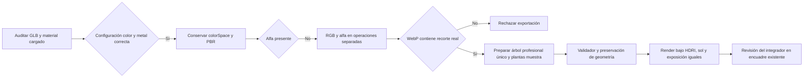

# Vegetación — auditoría material y una muestra de árbol

Observado el 23-10-2026 en America/La_Paz; registros UTC cruzan al 24-10. Alcance: diagnóstico y candidatos externos. No se modificaron `src/`, `public/`, servidor, distribución, cámara, exposición o Blender vivo. Fuentes originales preservadas sin sobrescribir.

## Diagnóstico confirmado

`material-audit.json` recoge lectura NodeIO, decodificación de texturas con Sharp y materiales cargados por GLTFLoader real en un navegador aislado. Los tres GLB activos auditados fueron `urbanTree`, `urbanShrub` y `urbanCalathea`.

| Propiedad | Árbol | Arbusto | Calathea |
|---|---|---|---|
| Diffuse colorSpace cargado | sRGB | sRGB | sRGB |
| Normal/ARM colorSpace | datos lineales | datos lineales | datos lineales |
| BaseColorFactor | blanco | blanco | blanco |
| Metalness efectivo | 0 | 0 | 0 |
| RoughnessFactor | 1 | 1 | 1 |
| Media G de mapa roughness | hojas .408; ramas .821; tronco .688 | .502 | .511 |
| Recorte | MASK .5 | MASK .5 | MASK .5 |
| Doble cara / depthWrite | sí / sí | sí / sí | sí / sí |
| Canal alfa real en diffuse | **ausente** | **ausente** | **ausente** |

Los mapas de datos y las conversiones de color cargadas son correctos. No hay evidencia para cambiar colorSpace ni metalness. La copa abierta procede también de la silueta del árbol fuente y no se resuelve mediante saturación o exposición.

**Fallo real del pipeline anterior:** `sharp(input).removeAlpha().joinChannel(alpha)` produce tres canales: `removeAlpha` se ejecuta después de la incorporación del canal. Se reprodujo con el diffuse y alfa oficiales del árbol. La reparación materializa primero un buffer RGB y añade después alfa en una segunda operación. El WebP final se verifica mediante `hasAlpha`, texeles transparentes y texeles visibles. `alpha-regression.json` demuestra salida anterior de 3 canales frente a nueva de 4, con 487 575 texeles transparentes. Esto corrige el mecanismo y añade rechazo de exportación si vuelve a perderse alfa.

Las afirmaciones anteriores de que los candidatos conservaban el alfa quedan **rectificadas por esta auditoría**. Pasar glTF Validator no comprobaba esa propiedad visual. La calathea heredó diffuse sin alfa del recurso previo; se preparó también una corrección externa con su máscara oficial. Se conservó el historial.

## Alternativa primaria de muestra

[Oak street tree, detailed leaves — Innerscene](https://www.innerscene.com/tools/library/3d-parts/oak-street-tree-detailed-leaves-a273fef9), original de Innerscene, [CC0 según página y términos oficiales](https://www.innerscene.com/tools/library/terms). Tiene 9 450 hojas de malla individuales, tronco y jerarquía de ramas originales. Es un modelo arquitectónico procedural; no contiene texturas, UV ni tarjetas alfa. Esa diferencia respecto de los recursos escaneados permanece explícita.

Fuente externa intacta: `C:/Projects/Assets/CarWash-Vegetation-Coherence-20261023/innerscene-oak/oak-detailed-original.glb`. SHA-256 `a02698ef246d8005110c291c510b8f7f397ae26e69414aa538cc4993b06256dd`.

Candidato: `C:/Projects/Assets/CarWash-Vegetation-Coherence-20261023/candidates/coherentOak-sample-v1.glb`.

- **213 372 triángulos originales conservados**, 9 450 hojas completas; sin simplificar ni inventar geometría orgánica.
- 5 354 748 bytes; dimensiones X/Y/Z 7.765 / 8.612 / 7.638 m; Y arriba.
- 4 nodos y 4 materiales; sin rig ni clips. Cientos de nodos de corteza se fusionaron por material. El render de inspección pasó de 1 251 a 9 calls incluyendo suelo y sombras, con el mismo total de triángulos. Esto no demuestra FPS del producto.
- Paleta solicitada aplicada **solamente a este recurso sin textura**: 5 670 hojas `#46733A` (60%), 2 835 `#24452C` (30%), 945 `#76A449` (10%). Asignación dispersa determinista de hojas completas, sin nubes uniformes ni tinte sobre mapas texturizados. Valores sRGB convertidos a lineal para glTF.
- Follaje no metálico, roughness .58; corteza .84. La forma del árbol y el apoyo se conservan; no se añadieron hojas ni se multiplicaron árboles.
- glTF Validator independiente: **0 errores, 0 avisos**. SHA-256 `9114f364ff0765c7504ccc8b6f71dba408170e6963b8fdcab993fd7a48d7b449`.

`oak-sample-v1-front.png` y `oak-sample-v1-side.png` muestran el resultado. Tiene mayor presencia de copa que el árbol activo, pero una corteza lisa y un carácter más ilustrativo que un escaneo. **No se declara equivalencia a la referencia ni aceptación artística.** El integrador debe revisar un único ejemplar dentro del encuadre existente antes de extenderlo.

## Prueba descartada

Se examinó primero [Jacaranda Tree de Poly Haven](https://polyhaven.com/a/jacaranda_tree), Rico Cilliers con orientación de Rob Tuytel, CC0. Fuente glTF real de 3 863 832 triángulos y BIN de 208 MB; no confundir con el resumen de 312K de la página. Candidato conservador de 662 674 triángulos / 32 340 036 bytes, con alfa correcto y 0 errores / 3 avisos de tangentes.

El render `jacaranda-v1-front.png`, con la iluminación común, muestra copa todavía demasiado abierta. Se **descarta artísticamente como reemplazo de esta toma** y se conserva externo como evidencia. No se intentó ocultar esa divergencia con exposición o saturación.

## Correcciones externas para una jardinera de muestra

| Candidato externo | Tris | Bytes | Alfa real | Validator |
|---|---:|---:|---|---|
| `coherentShrub-alpha-v1.glb` | 30 905 | 1 189 924 | 618 572 texeles < .5 | 0 errores / 1 aviso |
| `coherentCalathea-alpha-v1.glb` | 3 749 | 342 488 | 454 504 texeles < .5 | 0 errores / 1 aviso |

Ambos están en el mismo directorio `candidates`. Los avisos restantes son espacio tangente generado en runtime. Sin rigs/clips. El arbusto conserva sus flores pequeñas y el aspecto herbáceo: no se presenta como seto podado. Texturas y variaciones naturales de ambos permanecen, sin recolorearlas a los tres valores de la paleta.

`preservation-and-coverage.json` demuestra mediante hash que índices, atributos geométricos y UV de cada candidato coinciden con su activo de partida; también coinciden factores PBR y bytes de mapas normal/roughness. El único cambio visual de estos dos recursos es restaurar su máscara oficial en diffuse.

Previews comparables: `currentShrub-*` / `correctedShrub-*` y `currentCalathea-*` / `correctedCalathea-*`. Las máscaras y metadatos oficiales descargados están fuera del repositorio. Manifiestos completos junto a cada GLB; registros compactos dentro de esta carpeta.

## Condiciones y comprobaciones



La inspección usa `daylight.hdr` vigente, environmentIntensity .6, hemisferio `#d9eaff` / `#89917a` intensidad .7, sol `#fff0d4` intensidad 2.6 en [-22,30,18], ACES y exposición **1.05**. Árbol actual y candidato se normalizan a altura 7 m con frame ortográfico 12 m idéntico, resolución 1000×1000. El suelo de prueba y las sombras son iguales; no se reproduce la oclusión del edificio. Todos los previews completaron carga y captura sin errores de página.

La segmentación verde aproximada de las imágenes frontales iguales midió 39 482 píxeles para el árbol activo frente a 84 226 para la muestra; ocupación en su propio bounding box verde 27.1% frente a 42.5%. Es una señal limitada del volumen visible de esa proyección, no una medida botánica ni aprobación artística.

Comprobaciones ejecutadas: sintaxis de los 6 scripts del alcance, regresión alfa con fuente real, lectura/validación independiente de los 3 candidatos finales, hashes de fuente y preservación geométrica/PBR, capturas frontales/laterales. Versiones observadas: Node v22.19.0, Three 0.186.1, glTF Transform 4.5.1, Sharp 0.35.5. No se ejecutó suite del producto porque no se modificó producto; su validación pertenece a la integración.

Pendiente: revisar **un árbol y una jardinera** en la cámara y luz existentes, ajustar escala/contacto únicamente si hay evidencia, comprobar coste real en móvil y obtener decisión visual antes de ampliar. El árbol activo/fondo siguen intactos; el integrador conserva restauración de `site-background`.

## Reproducción

Los scripts rechazan sobrescribir los candidatos/evidencias existentes; cambiar el nombre de destino para un nuevo intento. Las fuentes no se sobrescriben.

```powershell
node docs/evidence/vegetation-coherence/material-audit.mjs
node docs/evidence/vegetation-coherence/alpha-regression.mjs
node docs/evidence/vegetation-coherence/prepare-oak-sample.mjs
node docs/evidence/vegetation-coherence/restore-calathea-alpha.mjs
node scripts/prepare-urban-vegetation.mjs shrub_01 C:/Projects/Assets/CarWash-Entrance-Urban-20261023 C:/Projects/Assets/CarWash-Vegetation-Coherence-20261023/candidates/coherentShrub-alpha-review.glb --coherence
node docs/evidence/vegetation-coherence/sample-preview.mjs newSample C:/Projects/Assets/CarWash-Vegetation-Coherence-20261023/candidates/coherentOak-sample-v1.glb 7 12
```

## Estado posterior de integración — 23 de octubre de 2026

El apartado anterior describe la entrega de candidatos del especialista. La integración posterior sí examinó la muestra y extendió los recursos: véase [INTEGRATION_REPORT.md](INTEGRATION_REPORT.md), capturas `sample/`, `after-materials/` y comparación real `comparison.html`. El fondo original se restauró por instrucción posterior del usuario. La aceptación artística continúa pendiente; la validación técnica no la sustituye.
