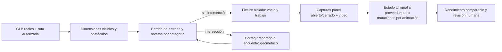

# Bahía 01 — auditoría de aceptación independiente

Fecha: 2026-10-23. Auditoría inicial ANALYZE/QA; posteriormente el integrador autorizó la corrección mínima de reversa y su prueba. No se inició navegador, GPU, build ni servidor. Se leyeron AGENTS.md, el perfil carwash_validation, carwash-visual-production y sus contratos/coordinación. Las conclusiones visuales quedan NOT_TESTED hasta capturas del incremento. Este documento no concede aceptación artística.

## Propietarios comprobados

| Capacidad | Fuente actual |
|---|---|
| Geometría/materiales de bahía | `src/world/prefabs/Architecture.tsx`, `WashBayPrefab`, `usePalette` |
| Barrera frontal, personal y equipos activos | `src/world/WorldLayout.tsx` |
| Rutas y poses físicas | `src/domain/sitePlan.ts`, `vehicleMotion.ts` |
| Normalización GLB y dimensiones visibles | `src/world/prefabs/Model.tsx`, `VehicleAppearance.tsx` |
| Animación del vehículo y ruedas | `VehiclePrefab.tsx`, `src/domain/wheelKinematics.ts` |
| Agarre y clips | `StaffPrefab.tsx`, `NPCAnimationController.ts` |
| Manguera dinámica/partículas | `ServiceActivityVisualizer.tsx` |
| Panel público | `src/ui/LocalAreaPanel.tsx` |
| Estado autorizado | `src/domain/DemoOperationSource.ts`, `server/demoApi.ts` |
| Pruebas reutilizables | `tests/unit/{asset-contracts,landscape,sow-operation,wheels}.test.ts`, `tests/e2e/{commercial,sow}.spec.ts` |

## Medición CPU ejecutada sobre GLB y rutas actuales

Se ejecutó Node con NodeIO/getBounds/ALL_EXTENSIONS, leyendo los cuatro GLB; se aplicó exactamente el límite uniforme de VehicleAppearance: `min(1,6.15/z,2.52/x,2.35/y)`. Dimensiones en metros, ancho × altura × longitud:

| Categoría | Fuente GLB | Escala | Visible |
|---|---|---|---|
| car | 2.180900 × 1.545139 × 4.840296 | 1 | igual |
| pickup | 2.320120 × 1.960124 × 5.690921 | 1 | igual |
| suv | 2.173500 × 1.729994 × 4.492967 | 1 | igual |
| truck | 2.734000 × 3.307000 × 7.390000 | 0.710614 | 1.942818 × 2.350000 × 5.251436 |

El truck no es el vehículo visible más ancho ni largo: pickup lo supera después del escalado. No usar únicamente la envolvente del truck para declarar compatibilidad de todas las categorías.

La abertura posterior actual está entre x=1.925 y x=4.875 (2.95 m). El ingreso llega por detrás desde z=-14 hacia el centro (3.4,-4.2). La barra frontal está en z=1.45; no atraviesa el ingreso central actual.

Barrido OBB rectangular conservador del truck visible, cada 0.025 m, SAT contra pared posterior izquierda/derecha y barra frontal:

- Entrada `bayEntryRoute(0,'01')`: **sin intersecciones** contra esos tres obstáculos.
- Salida `bayExitRoute('01')`: **29 muestras intersectan la pared posterior derecha**, primera distancia 6.225 m, centro (3.104921,-10.382592), yaw -2.648605. El giro de reversa empieza antes de despejar completamente la abertura.
- Este resultado prueba solapamiento de envolventes, no contacto de triángulos exactos. `sampleRoute` tampoco incluye el retraso de orientación del renderer: comprobar la ruta real en vídeo y con poses observadas sigue siendo obligatorio.
- No se ha demostrado aquí colisión con barra frontal. Cambiarla por esa causa sería injustificado.

El suelo de bahía termina en y=0.005. El vehículo se coloca en y=0.035 (30 mm de separación nominal; revisar apoyo visual). El carrito normalizado mide 1.188088 × 0.9 × 0.703127; base y=0.01 (5 mm sobre suelo). La manguera está normalizada a 0.879826 × 1.05 × 0.471856; su base y=0.8 requiere soporte de pared verificable, no contacto con piso. El equipo sprayer tiene base y=0.02 (15 mm sobre piso). Son anclajes, no prueba de que ruedas/patas concretas apoyen: inspeccionar primeros vértices/contactos.

## Contratos y aceptación del primer incremento



```text
para cada categoría real:
  leer GLB y aplicar normalización del renderer
  barrer entrada y salida completa con OBB + margen explícito
  comprobar paredes, postes, carro/equipos, barreras y vehículos estacionados
en servidor aislado y build fijo:
  capturar Bahía01 vacía sin crear órdenes
  establecer fixture sintético autorizado por proveedor
  grabar ingreso, parada, trabajo y salida desde cámara real
  verificar panel contra snapshot y que navegación no cambia comercio
  comparar antes/después con luz, exposición, cámara y fixture registrados
```

| ID | Aceptación concreta | Estado de esta auditoría |
|---|---|---|
| B01-PATH | Cuatro categorías: entrada y salida sin OBB/mesh invadiendo geometría; reversa despeja abertura antes del giro; corredor libre | Truck entrada medida; salida OBB con fallo; resto pendiente |
| B01-FIT | Techo, vigas y fascia dejan gálibo a cada modelo visible; ancho/longitud no sustituyen altura | Dimensiones medidas; integración completa NOT_TESTED |
| B01-SUPPORT | Carrito apoyado; soporte de manguera unido a estructura; drenaje integrado sin flotación/z-fighting | Anclas medidas; visual NOT_TESTED |
| B01-EMPTY | Sin entidad no hay trabajador, partículas ni coche decorativo; bahía legible como espacio terminado | Contrato fuente observado; navegador NOT_TESTED |
| B01-STATE | Disponible/Asignada/etapa real coinciden con bay+vehicleId; exterior/interior/focos/inspección/listo correctos | Lectura de productor/consumidor; navegador NOT_TESTED |
| B01-ACTION | Consultar mi vehículo usa únicamente ID de sesión; sin orden explica paso necesario | Reusar flujo comercial; NOT_TESTED aquí |
| B01-TOOL | Mano/agarre/boquilla/superficie visibles en vídeo; manguera termina en equipo y mano; no efectos fuera de tarea | attached:true no basta; NOT_TESTED |
| B01-UI | Panel cerrado/abierto en 1855×848,1440×900,390×844; trabajo, número y acción visibles, touch ≥44px | NOT_TESTED |
| B01-PERF | Misma versión navegador/GPU/DPR/fixture/cámara, calentamiento igual, muestras p50/p95 frame time, drawcalls/triangles/textures | NOT_TESTED; no prometer FPS por menos objetos |

## Pruebas reutilizables y brechas

- `landscape.test.ts` ya utiliza SAT de vehículo contra jardineras; reutilizar método para paredes/postes, pero leer dimensiones reales. Su envolvente fija 2.95×8.4 es una política conservadora de jardineras, no la escala visible del truck.
- `asset-contracts.test.ts` comprueba ruedas y dimensiones de primitivas; para gálibo usar transformaciones globales de nodos y la normalización de VehicleAppearance.
- `sow-operation.test.ts` ya verifica operación vacía, bloqueo de doble asignación, FIFO y ausencia de autoavance de tareas. Añadir geometría no debe modificar esas expectativas.
- `commercial.spec.ts` prueba ruedas por distancia y congelación al pausar; guardar vídeo y poses durante giro/reversa para detectar la orientación interpolada real.
- `sow.spec.ts` contiene el recorrido autorizado completo llegada→fila→asignación→trabajo→entrega, incluido rechazo de acciones administrativas del cliente. Reutilizarlo en instancia aislada, sin modificar tarifas para producir un truck.
- `ServiceActivityVisualizer` dibuja la manguera desde un punto fijo aproximado del equipo hacia `anchor.grip`; la boquilla se aproxima con offset del GLB. Requiere inspección de vídeo. Spray apunta a coordenadas fijas de carrocería, no geometría por categoría; probar pickup y truck además de car.
- `LocalAreaPanel` elige `focusedVehicleId || bay.vehicleId`; la navegación de botones limpia el foco. Verificar también acceso desde objeto y retorno para impedir que el panel de Bahía01 muestre tareas del vehículo enfocado de otra bahía.

## Recetas de fixtures y capturas (propuestas, no ejecutadas)

No ejecutar estas acciones contra la operación compartida 4173. El integrador debe disponer una instancia de prueba aislada con puerto y directorio de build explícitos. Cambiar puerto de frontend no aísla backend si se reutiliza el mismo proceso/proxy.

### Vacío

Reutilizar el guard de `scripts/capture-pilot.mjs`: HTML servido debe contener el entry de dist, sin `/@vite/client`; SHA256 JS/CSS/GLB antes/después idénticos. Navegar URL sin `scenario`, esperar `[data-ready=true]`, comprobar `snapshot().world.vehicles.length === 0`, ir El local→Bahía01, capturar abierto/cerrado y snapshot. No usar `reset` del escenario operation: no existe y no debe agregarse para acomodar QA.

### Trabajo sintético rotulado DEMO

Para baseline visual sin orden: `/?scenario=mixed&tools=demo`, que ya posee vehículo sintético en Bahía01. Usar **instancia aislada** porque mixed se comparte entre sesiones del mismo servidor. Después de conectar SSE, obtener nonce de `/api/demo/session`, POST `/api/demo/tools?scenario=mixed&speed=1` con Origin del puerto, nonce y `{sandbox:true,action:'pause',paused:true}`, luego reset. Conservar captura fija pausada, y otra grabación breve reanudada para mano/partículas. Pausar antes de la primera conexión no basta: SSE puede reactivar el stream.

```js
const session = await (await page.request.get(`${base}/api/demo/session`)).json();
const command = async data => {
  const response = await page.request.post(`${base}/api/demo/tools?scenario=mixed&speed=1`, {
    headers: { Origin: new URL(base).origin, 'X-Demo-Nonce': session.nonce },
    data: { sandbox: true, ...data }
  });
  if (!response.ok()) throw new Error(`Fixture command failed: ${response.status()}`);
};
await command({action:'pause',paused:true});
await command({action:'reset'});
// Esperar snapshot.paused y stage washing en bayId01; capturar antes de reanudar.
```

Para ingreso/salida por categoría, reutilizar el flujo administrativo de sow en esa instancia. Si la tarifa truck no existe, **no inventar tarifa**: ejecutar primero la prueba de dominio con `new DemoOperationSource('operation')`, `addOrder('fixture-truck', ['exterior'], '#aaa', 'truck')`, `assignOrder(...,'01')`, muestrear su movement. Un fixture visual de transporte adicional requerirá un adaptador de prueba explícitamente aislado o flujo autorizado disponible; nunca mutar Zustand de producción para simular autorización.

Conservar videos, consola, snapshot comercial antes/después, build/hash, GPU/renderer, viewport/DPR, cámara/FOV, clima/exposición, reloj operativo y fase del clip. `diagnostics.sightLines` es solo un contenedor hasta demostrar productor activo; no usarlo como aceptación de visibilidad.

## Corrección autorizada y comprobación CPU posterior

Se modificó únicamente `reverseRoute` en `src/domain/sitePlan.ts`: prolonga reversa recta hasta el punto de control z=-14 y gira hacia z=-15. Conserva IDs, capacidad, entrada, destino de entrega, autoridad comercial y mecanismo de cambio de marcha; su duración se calcula por longitud existente.

Se creó `tests/unit/bay-clearance.test.ts` con lectura de GLB reales, escala visible, margen horizontal de 5 cm, muestreo cada 2.5 cm, cuatro categorías y cinco bahías. Verifica entrada/salida contra todas las paredes traseras, postes, barreras frontales y jardinera posterior, además del gálibo bajo fascia con 10 cm de margen vertical.

Intento 1 ejecutado 22:13:05: candidato z=-13 antes de girar a z=-15; **11 PASS / 1 FAIL**. Pickup todavía invadía envolvente de pared posterior derecha, posición (3.378326,-11.874302), yaw -2.968963. El redondeo inicia el giro antes de alcanzar el punto de control. Se conserva este fallo como evidencia, no se redujo el margen ni se omitió la categoría.

Intento 2 ejecutado 22:13:31: punto recto z=-14, mismo giro y algoritmo; comando `npx vitest run tests/unit/bay-clearance.test.ts tests/unit/landscape.test.ts tests/unit/sow-operation.test.ts`: **12/12 PASS, 3 archivos, exit 0**. Incluye regresión de suelo/rutas y autoridad de operación. Sigue pendiente vídeo del movimiento interpolado real y aceptación visual. Las dimensiones de obstáculos en la prueba reflejan la geometría actual: actualizar el contrato si cambia WashBayPrefab; no presentar las envolventes como colisión exacta entre mallas.

Integración posterior: la suite completa detectó discontinuidad angular de 0.03664 rad al cambiar reversa a avance, superior al límite existente de 0.02. La continuación aún utilizaba z=-13.2 aunque el final de reversa estaba en z=-15. Se corrigió su primer tramo a `[48,end[1]]`, manteniendo tangente horizontal y conservando la prueba sin relajarla. `npm test` ejecutado 22:23:57: **65/65 PASS, 14 archivos, exit 0**, incluidos barrido de cuatro categorías/cinco bahías, jardineras y continuidad de marcha. No se ejecutó build ni GPU.
