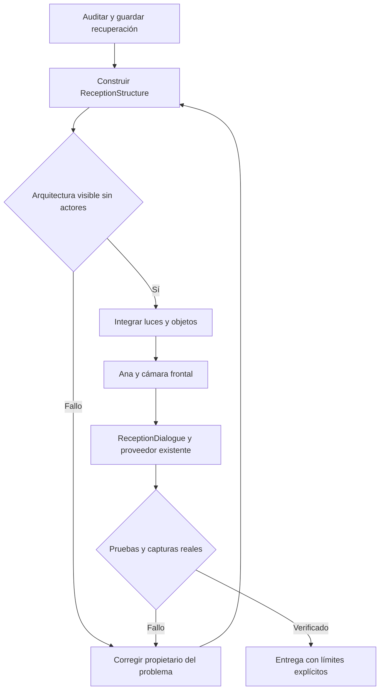

# Recepción por capas — 24 de octubre de 2026

Activación: `/?layer=reception` o `/world3d`. Inspección sin personaje ni interfaz:
`/?layer=reception&stage=architecture`; con lámparas, objetos y plantas:
`/?layer=reception&stage=lights`. `/?layer=landscape` y `/?layer=ground` conservan
sus vistas independientes. La marca continúa procediendo de la configuración.

## Responsabilidades y contratos

| Componente | Responsabilidad | Invariante |
| --- | --- | --- |
| receptionPlan | Anclas en metros, dentro de la huella existente | No desplaza calles ni otras zonas |
| ReceptionStructure / receptionMaterials | Arquitectura, madera, rótulos y lámparas | Nombre configurable, texto directo sin placa |
| ReceptionProps | Plantas laterales, reloj, monitor e información | Emite intención; no confirma órdenes |
| ReceptionCamera | Entrada y aproximación frontal | La cámara permanece delante del mostrador |
| ReceptionExperience | Sesión y paneles existentes | Proveedor DEMO existente; no inicia simulación de bahías |
| VehicleCategoryButtons | Selector visual del catálogo | Categorías y precios pertenecen al proveedor |
| StaffPrefab / NPCAnimationController | Saludo y gestos | Saluda en bucle solo durante bienvenida; movimiento reducido usa Idle |



```text
preservar suelo, fondo y distribución
montar recepción solo en la capa solicitada
al llegar: abrir bienvenida sin crear orden
mientras bienvenida y movimiento permitido: repetir Greet
al elegir acción: detener saludo y mostrar flujo existente
al elegir categoría: actualizar borrador e invalidar cotización anterior
al cerrar o regresar: conservar servicios seleccionados
ante fallo de proveedor: informar y permitir reintento explícito
ante fallo de recurso 3D: mostrar recuperación y acceso a paisaje
```

## Detalles visuales

Mostrador de 1,05 m con listones y cantos biselados. El rótulo frontal repite
el nombre claro grande, subtítulo rojo menor y barra roja de la pared.
Dos lámparas con rosetón, casquillo y suspensión conectados al techo; difusor
crema luminoso, borde cálido y halo suave, siguiendo WarmDiffuser del jardín.
Iluminación puntual dirigida al mostrador sin cambiar exposición global.
Reloj circular de marco metálico fino y esfera oscura, hora local; monitor delgado
con pedestal y teclado; señal informativa con base e icono circular.

Plantas anchas y arbustos en macetas laterales mantienen despejados rostro y
mostrador. En recepción se conserva el verde original de las hojas; el tratamiento
oliva exterior permanece independiente. Se redujo la cubierta baja para que
sus raíces no excedan las macetas.

## Corrección botánica solicitada

Actualización del mostrador: se retiró la cubierta baja de las macetas y las
plantas laterales se desplazaron hacia atrás, reduciendo su altura a 0,83 m.
Las cuatro envolventes de vegetación quedan fuera de la envolvente del mostrador;
resultado medido en `plant-counter-clearance.json`. Las macetas tienen perfil
interior modelado, borde redondeado, tierra texturizada hundida y pequeños áridos.

Se retiró la barra duplicada Servicios/Horarios/Preguntas/Hablar con Ana.
ReceptionHotspot proyecta objetivos accesibles sobre cada objeto físico, con
indicación de interacción y explicación al pasar el cursor o usar teclado.
El expositor Ofertas abre únicamente promociones publicadas no vencidas; vacío
honesto cuando no hay ofertas. La pantalla del monitor usa fondo blanco y texto
oscuro. Ana se puede tocar directamente: vuelve a bienvenida y saluda, preservando
la selección del borrador. Su burbuja lateral es texto local; no se conectó IA.
Tras la revisión del usuario se redujo a 112 px, con el saludo breve
«¡Hola! Soy Ana. Tócame para hablar.» y se oculta al abrir cualquier panel.
La prueba comprueba que no interseca los cinco accesos físicos del mostrador.

El generador anterior distribuía bases de hojas sin ramillas de conexión.
Se añadieron ramillas respetando las posiciones y la semilla existentes.
Solo se promovieron warmShadeTree y warmShrub desde el candidato aislado
`C:/Projects/Assets/CarWash-Botany-Connected-20261024`.
El archivo Blender fuente queda allí; no se modificó la escena Blender abierta.
Ambos GLB pasaron validación sin errores ni advertencias.
`docs/evidence/phase03/leaf-support.json` registra 0 bases sin soporte tras
la corrección (tolerancia geométrica 2 cm), frente a 6773 y 572 antes.
Esta medición comprueba conexión, no equivalencia fotográfica.

## Evidencia y recuperación

`docs/evidence/phase03/` contiene arquitectura, iluminación, entrada, recepción,
catálogo, estados de error y vistas móviles. `acceptance/` contiene capturas del
flujo ejecutado con Playwright. `recovery/source-before.zip` preserva las fuentes
previas de esta intervención, incluido trabajo local anterior; no es un checkout
limpio de Git. Los GLB originales también están en `recovery/`.

El primer intento de compilación del selector usó un icono no exportado por la
versión instalada de Lucide; se sustituyó por SVG local de pickup, sin dependencias.
La primera prueba de categoría esperaba un texto sin el sufijo DEMO; se corrigió
el localizador contra el texto realmente mostrado, conservando la condición de
tres servicios que requieren cotización.

Las muestras RAF headless anteriores están en baseline/result.json y
full/result.json: mediana escritorio 34,5 / 34,7 ms; móvil 21 / 21 ms.
Son orientativas: cámaras y contenido diferentes, no benchmark controlado ni
garantía de FPS en dispositivos del cliente.

Limitaciones: proveedor local DEMO, sin integración .NET ni pagos de producción.
Se reutilizan los clips reales disponibles; no hay clips específicos Confirming
o Farewell ni nuevas expresiones faciales. La aceptación artística corresponde
a la comparación visible con las referencias, no a que una prueba compile.

Los indicadores sobre los objetos utilizan una mano con índice extendido, en lugar de flechas.
