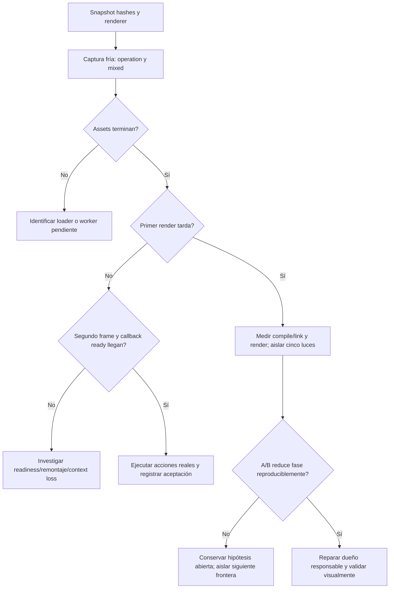

# Auditoría de carga para cierre con Visual Studio

Fecha: 2026-10-24. Modo: análisis CPU, sin navegador nuevo, build ni cambios de producto.

## Resultado

La causa raíz sigue sin confirmar. Hay evidencia más específica que «GPU lenta»: un caso fallido ya dibuja el mundo completo, pero no alcanza el segundo frame que libera readiness. La hipótesis prioritaria es bloqueo en compilación/render inicial de la escena activa. No atribuirlo todavía a las cinco luces de bahía.

## Observaciones reproducibles

- Git estaba limpio al comenzar. Historial revisado: `docs/evidence/diagnostico-ux-20261023/full-attempt-1.log`, `full-result.json` y traza de `commercial-Preguntas-autor-a8b2a-a-nunca-enviada-sin-backend-commercial`.
- FULL histórico: 32/38. Cinco casos fallan exactamente esperando `[data-ready=true]`, antes de sus acciones. No prueba fallos de tarifas, preguntas, clima o ruedas. El sexto caso administrativo tiene mecanismo independiente (selector), revalidado por otro chat; no repetido aquí.
- En traza Preguntas todos los recursos HTTP consultados devuelven 200. Dense GLB tarda 561.739 ms en red; otros GLB/HDR también completan. Un blob queda pendiente al cerrar. Red completada no prueba decodificación/compilación completadas.
- `goto` empieza en 774115.213 ms; espera ready en774207.066; hay frames hasta775900.255; warning de programa shader en776858.679; siguiente frame815698.643; timeout834218.372. Hay39.8 s entre esos dos últimos frames de compositor. Esto no es una medición de gl.render y no identifica qué programa bloqueó.
- Último fotograma de esa traza muestra mundo, edificios, vegetación y vehículos, con overlay «Preparando tu visita…». Extraído sólo para inspección a `%TEMP%/carwash-readiness-last.jpeg`; original permanece en trace.zip.
- Consola de ese caso: deprecación THREE.Clock y warnings numéricos de compilador ANGLE; no error de programa. Un warning no demuestra un shader inválido.

## Mecanismo actual y propietarios

| Frontera | Dueño | Riesgo / evidencia |
|---|---|---|
| Escenario inicial | `src/app/store.ts` | `scenarioFrame` instala mixed/arrival antes de readiness; por tanto esas rutas cargan vehículos y trabajadores desde el primer montaje. |
| Carga y montaje | `src/world/WorldScene.tsx` | Suspense único agrupa HDRI, mundo, badges y Ready. No hay señal por fase de carga. |
| Readiness | `WorldScene.tsx` Ready | Se agenda ready sólo al segundo useFrame, mediante otro requestAnimationFrame. No hay reloj visible para assets/primer render/segundo render. |
| Transporte | `src/app/App.tsx`, `DemoOperationTransport.ts` | SSE operativo abre sólo cuando ready es true. No culpar al SSE de que ese primer ready no llegue; estado inicial ya contiene la fixture. |
| Luces | `prefabs/FinishedWashBay.tsx`, `LoungePrefab.tsx` | Cinco rectAreaLight de bahías + una lounge global. PBR de activos aumenta combinaciones/coste; plausible, no probado. |
| Modelos | `prefabs/Model.tsx` | Clone + bounds precisos + sombras en todas las mallas. Puede añadir CPU inicial; no duración registrada. |
| Textos | `prefabs/Architecture.tsx` Lettering | Fuente local Manrope; generación SDF/worker sigue siendo frontera posible. No hay prueba de espera por fuente remota. |
| Luz/entorno | `environment/WeatherEnvironmentController.tsx` | HDRI/PMREM y shaders iniciales bajo Suspense. Los seis climas no se ejecutaron en el caso fallido, así que no atribuir fallo a transición climática. |

## Experimento discriminante propuesto (root, una GPU)



Pseudocódigo:

```text
congelar source/dist/activos; no alterar datos comerciales
para escenario en [operation, mixed]:
    abrir un contexto frío 1440x900 con un solo browser
    desde init-script registrar rAF, longtasks, contextlost y tiempos WebGL
    envolver render y compile/link conservando this, argumentos y retorno
    registrar loader-resolved / primer-frame / segundo-frame / ready
    esperar máximo 60s; guardar resultado aun si falla
    cerrar contexto
si render/compile es la frontera observada:
    comparar candidato idéntico sin SOLO las cinco rectAreaLight de bahías
    no confundir intensidad cero con retirar variante de luces
    repetir un par A/B frío si la diferencia es sustancial
no ampliar timeout para declarar PASS
no modificar Ready para ocultar que el mundo todavía no funciona
```

Ideal: instrumentación de carga en Canvas.onCreated y componente fuera del Suspense; Ready puede no estar montado durante la fase que interesa. Instrumentar sólo Ready dejaría el mismo punto ciego. `gl.info.programs`, renderer, tiempo de compilación, primer render, frames y contextlost deben persistir fuera de la página ante timeout. La prueba aislada no debe activar tracing/vídeo con credenciales administrativas.

## Contratos y aceptación

- Invariante: mismo fixture, cámara, luz ambiental, recursos y viewport en A/B; única variable cinco luces.
- Readiness no implica sólo HTTP200: debe haber escena visible, frames continuos y acción cliente completada.
- Aceptación técnica pendiente: los cinco flujos originales ejecutan sus acciones y checks sin errores; registro de arranque y comparación visual sin degradación. Aceptación artística humana separada.
- Fallos históricos conservados. Ya hay repetición de la misma frontera: no seguir relanzando suites idénticas ni aplicar parches incrementales sin identificar dueño/contrato responsable.
- Este informe no implementa reparación ni reclama PASS nuevo. No se ejecutaron pruebas GPU ni unitarias (análisis documental).

## Actualización: probes ejecutados por el integrador

Se leyeron los recibos reales `docs/evidence/studio-closure/{original-lights,consolidated-lights,five-lights-controlled}/startup.json`. Esta auditoría no abrió otra GPU. El integrador sustituyó las cinco luces de bahía por una luz continua de fila en `WorldLayout`; el lounge conserva su luz independiente.

| Variante | Vacío, ready | Mixed (6 vehículos), ready | Errores de página / fallo |
|---|---:|---:|---|
| original-lights (build anterior, contexto histórico) | 17.048 s | 34.472 s | 0 / ninguno |
| consolidated-lights (una luz de fila) | 9.591 s | 15.845 s | 0 / ninguno |
| five-lights-controlled (cinco luces restauradas en mismas fuentes de recepción) | 17.077 s | 31.620 s | 0 / ninguno |

La comparación pertinente es **five-lights-controlled frente a consolidated-lights**: en estas muestras el tiempo hasta ready baja 7.486 s en vacío (~43.8 %) y 15.775 s en mixed (~49.9 %). El integrador mantuvo las demás fuentes de recepción y el mismo instrumento entre esas dos variantes. `original-lights` tiene un build y una versión de muestreo distintos; sirve como contexto, no como A/B puro.

Los tres recibos identifican el mismo renderer ANGLE Intel UHD / D3D11. En el par controlado, los dos intervalos largos iniciales de rAF en vacío son 8.041/7.075 s con cinco luces frente a 4.576/3.131 s consolidadas; en mixed, 14.658/14.074 s frente a 6.777/6.069 s. La reducción es coherente con el menor coste de la configuración luminosa. Sin embargo:

- Hay una observación por variante/escenario, no distribución estadística ni benchmark robusto.
- `probe.calls` permanece vacío: **no se midió directamente una duración de compile/link/gl.render**. Los huecos rAF no distinguen por sí solos CPU, compilación de driver y GPU.
- `drawCalls: 0` en el recibo temprano no significa escena sin draws; ese contador de producto se actualiza cada 30 frames y los probes terminan antes en varios casos.
- Todos estos probes alcanzaron ready dentro del límite, también con cinco luces. Por tanto no reproducen los timeouts históricos y **no prueban que las luces fueran su causa única**.
- Los warnings de THREE.Clock y precisión del shader en vacío aparecen en ambas variantes; no usar su mera presencia como criterio de fallo.
- La optimización no concede aceptación visual: la nueva luz continua debe conservar iluminación útil de trabajadores, coches, suelo y materiales desde las cámaras reales.

### Resumen técnico para Visual Studio

**Estado: mejora de arranque observada; cierre funcional pendiente de suite final.** La iluminación de la fila se consolidó de cinco emisores de área a uno. Un par controlado registró ready en 9.6 s vacío / 15.8 s con seis vehículos frente a 17.1 s / 31.6 s con cinco emisores. Sin errores de página en esos probes. La evidencia apoya conservar y verificar la optimización, pero no demuestra resolución definitiva de los cinco fallos históricos. Es necesario ejecutar sus acciones de cliente en la suite final, conservar recibos y revisar las capturas. La aprobación artística sigue siendo humana.
